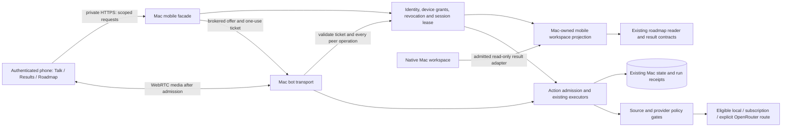

# Mortimer phone access — provisional implementation draft

2026-10-22 UTC · PROVISIONAL DRAFT revision 5.3 · S0 test-local candidate authored; focused synthetic checks pass; independent oracle review pending · Fable 5.1 approved exact revision 5.2 for documentation integration; revision-5.3 author amendments are not independently re-reviewed · Phone runtime design remains provisional and unaccepted · Development and acceptance testing

**Goal:** do the supported work from within Mortimer, with the phone as another Mortimer interface for conversation, results, roadmap, approvals and model management. Execution, credentials and authoritative state remain on the Mac. The initial delivery stays bounded to foreground conversation and admitted result/roadmap views; the parity matrix below identifies later work explicitly. This product direction is not permission to bypass content grants, confirmation or existing ownership.

**Original evidence boundary (revision 1–4; current reconciliation in §13):** inspected repository source at `b97a8b3796de3f34e55ba07c9d9fc6025b5ffe68`; no application builds/tests, microphone use, credential extraction, network changes or deployment. No iPhone was inspected. Device/OS compatibility, enabled authentication, private connectivity, loaded build and actual voice behavior remain unverified. The parent selected Astra for drafting; available runtime metadata did not expose the executing model, so actual drafting attribution remains independently unverified.

**First independent review:** the provider owner completed a tools-disabled review through Larry's authenticated Max subscription, with no automatic fallback or inherited direct-API credentials. Its receipt confirms returned model `claude-fable-5-1`, success at 2026-10-22 00:29:33 UTC, and original draft SHA-256 `7f685ee8ba39e98b7ce49a22949c4b4458b997fc8f644ab779e357813c73bf45`. Verdict: **revise before adoption**. Revision 2 responded to that review; its author dispositions are preserved in §10. Reviewer suggestions are evaluated, not treated as new authority.

**Historical follow-up review — revision 2, 2026-10-22 00:42 UTC (later reconciliation reviews in §13 and final receipt in §14):** a second tools-disabled review completed at 2026-10-22 00:42:56 UTC, returning exact model `claude-fable-5-1` through authenticated Max. It reviewed immutable revision 2, SHA-256 `9939fa5be2eb616dc559813b4e6cd08e596889e99c3a694f5afceace194c67ac`, and found all eight original findings resolved at design level. Verdict: **ready for provisional adoption subject to the listed decisions**, with B1/B2 text amendments. At revision-3 authoring, those amendments and context/media clarifications had not yet received another independent review. This is architecture-prose review, not source verification, implementation approval or acceptance. The full dispositions are in §10/§11. At revision-4 authoring, Larry’s Mortimer-first clarification and deferred workflow matrix (§2, §6, §12) had not yet received another independent model review.

The phone runtime design remains a reviewable proposal, not design adoption or a runtime implementation claim. WS-30’s bounded synthetic S0 claim landed on main through #268 (§14/§15); the test-local candidate is now authored, with independent fixture/oracle review pending. On adoption, extend the existing **WS-04 remote-access plan** and coordinate bounded dependencies with WS-17, WS-05 and WS-24; do not create a competing remote-access plan. No shared numbers, ports, migration IDs or configuration names are reserved here. The existing release owner retains the development installation and acceptance work.

## 1. Evidence and implications

All source references below are relative to `Larryfix71566/jarvis-voice-ai` at the pinned commit. The local evidence manifest records hashes for 30 relevant files, all matching that commit when inspected. The cached `origin/main` matched; no fetch was performed and this is not a claim about the latest remote tip.

| Observed source | What can be reused; what remains missing |
| --- | --- |
| `jarvis/bot/bot.py:23–68`, `jarvis/bot/server.py`; `web/src/jarvisClient.ts:1–26` | SmallWebRTC and `/api/offer` already carry remote media and app messages into the same pipeline used by local native WebSocket `/ws-client`. Reuse transport and pipeline separation. This does not prove phone/WAN readiness. |
| `jarvis/auth.py:63–105,314–334`, `jarvis/authmw.py:101–175`, `jarvis/bind.py:103–165` | Existing hashed client tokens, request identity/tenant scope, pure-ASGI HTTP/WebSocket authentication and independent auth/remote-bind guards. Dormant defaults force loopback. Tokens do not implement scoped mobile grants or a complete pairing/session lifecycle; revoking a database row alone does not tear down already-established media. |
| `docs/plans/MORTIMER_REMOTE_ACCESS_PLAN.md`, Addenda R1/R2; `ROADMAP.md`, WS-04 | Existing private-tunnel direction and token-auth requirement. R2 onboarding/provisioner and enabled-mode acceptance remain open in the source record. Remote activation is a separate decision. Old baseline sections are historical; use addenda and current source. |
| `web/src/api.ts:1–32`, `web/package.json`, `CLAUDE.md` | React/Vite client and Pipecat headers are reusable. Current browser bearer storage is `localStorage`; web is a frozen fallback. It is not a secure mobile pairing implementation or a current native-console equivalent. |
| `macos/JarvisKit/Package.swift:6`, `JarvisClient.swift:117–125` | Library declares macOS 26 and iOS 26; remote URLs select WebRTC. Useful protocol, codec and transport reuse for native iOS, but a declared platform is not evidence that an iPhone build or UX is accepted. MortimerHost remains a Mac UI. |
| `jarvis/bot/console_protocol.py:128–182,302–376`, `console_session.py:19–106`, `console_actions.py:256–389` | Versioned actions, stable UUIDs, session/generation/revision checks and bounded duplicate-response handling exist. Replay cache is in memory, 128 responses/300 seconds; this is not durable action recovery across restart. |
| `macos/MortimerHost/.../Stores/WorkspaceStore.swift:101–108,175–292`; `.../Display/RoadmapView.swift:172–265` | Native store owns result inventory and view state. Roadmap filters and refresh already have defined semantics. Existing inventory is a bounded projection, not the complete result store or a remote synchronization service. |
| `mcp_servers/mcp_repo/logic.py:163,314–340`, `jarvis/bot/pipeline.py:476–501` | Canonical roadmap parser/provenance and guarded fixed-source refresh exist. Reuse them. Roadmap filters are view operations; editing roadmap ownership/checkmarks is a separate workflow. |
| `jarvis/bot/pipeline.py:1107–1140` | `make_private_result_sink` sends protected body content through the current transport. “Local result” labeling alone is insufficient once that transport reaches a phone. Remote display admission must run before serialization. This observation is a design dependency, not a claim that a remote leak currently occurred. |
| `jarvis/bot/pipeline.py:1212–1217`, `jarvis/provider_access.py:130–144` | Pipeline readiness deliberately refuses voice in both `subscription_only` and `direct_apis_disabled` modes. A candidate subscription adapter exists, but its early readiness gate remains. Phone voice must not bypass it. |
| `jarvis/provider_access.py:44–117`, `jarvis/privacy_policy.py:29–67`, `config/model_access.yaml` | Selective retirement preserves explicitly validated OpenRouter requests alongside subscription/local routes. Full payload/source policy and no implicit fallback remain mandatory. Direct OpenAI/Anthropic APIs are retired by the user’s instruction. |
| `jarvis/bot/pipeline.py:2033` onward; `ROADMAP.md`, WS-24 | Session construction includes startup reconciliation/pruning. A second client must not accidentally orphan another session’s work. Durable task recovery remains a parked future foundation. Audit lifecycle ownership before allowing concurrent phone/Mac sessions. |

The original revision-4 acceptance snapshot records #232/#233/#234 and native compatibility #235 merged, with exact-source verification evidence. It explicitly separates source checks from installed/loaded identity and live acceptance. The initial installed-checkout read returned `b136a2a...`; that alone attests neither app nor running backend. The release owner is active and may change this state. This proposal closes no acceptance checkbox and does not repeat that owner’s tests.

Repository guidance read: `AGENTS.md`, `CLAUDE.md`, roadmap protocol/workstreams/conflicts, architecture/map, allowlist sequence and `skills/technical-plan-document/SKILL.md`. The explicit instruction for a workspace-only read-only plan supersedes repository fetch/claim/edit and in-app `plan_start` procedures for this task. It grants no later implementation authority. Auth/bind, manifests and security controls retain their human-owned review boundaries.

## 2. Decisions and alternatives

1. **Recommend a foreground mobile web client first, with optional home-screen installation later.** It provides the shortest path to voice plus visible cards using existing React/Pipecat code. Create a bounded mobile entry point after explicitly reopening that scope; preserve the frozen fallback. Do not start by porting the entire native console. Native iOS is the next choice if screen-lock/background calls or stronger device storage are requirements. A WebView wrapper alone does not solve audio lifecycle or session security.
2. **Keep the Mac as the execution and data authority.** The phone captures audio, renders authorized projections and submits typed actions. No provider keys, agent runtime, arbitrary shell, direct database access or provider endpoint selection on the phone. Remote desktop streaming is rejected: it exposes excessive screen content and makes touch interactions, private display policy and reconnect semantics harder to control.
3. **Reuse SmallWebRTC for audio and transport-neutral console contracts for actions.** Do not send raw local PCM WebSocket audio over the WAN as the default, or fork Pipecat. HTTPS signaling is not proof of media reachability. Verify the pinned SDK’s offer/PATCH, ICE and reconnect behavior independently before selecting any network design.
4. **Place a narrow mobile facade in front of existing Mac services.** It serves only mobile session/status, admitted results, roadmap projection and allowlisted commands. Reuse business logic behind it; do not expose the complete admin sidecar, its status logs, internal creator routes or self-edit APIs. A private network is defense in depth, not a replacement for caller authorization.
5. **Use a distinct mobile view workspace initially, with an admitted read-only Mac results projection.** Ordinary results explicitly selected for phone display and the canonical roadmap are available without taking over Mac windows or running a model. The host can grant access to a bounded ordinary-result collection; it does not export all current or future cards by default. A narrow read adapter under WS-17 ownership preserves source result IDs and classifications. Protected/unclassified results remain denied. Mobile selection/pinning/closing affects the mobile view only; write-through Mac window control and full conversation continuation remain later scopes.
6. **Protected content stays on the Mac by default.** Phone display is a distinct egress destination requiring a separate, revocable grant. Model/subscription/OpenRouter and STT/TTS processing need their own eligibility. Authentication by itself grants none of these content permissions.
7. **First experience supports foreground push-to-talk, Stop speaking and explicit Resume.** Open-mic conversation follows proven interruption/reconnect behavior. Always-listening wake word, background wakeup and screen-locked browser recording are excluded from the first contract.

### Mortimer workflow parity — initial scope versus later delivery

The phone is a Mortimer client using the same host workflow and policy contracts. A separate mobile layout is acceptable; a separate registry, task authority, approval authority or operator console is not the intended product. Routine supported actions should be initiated, explained, confirmed and inspected in Mortimer. An unavoidable physical Mac unlock or OS permission remains an explicitly described recovery step, never a promise that the phone can bypass the OS.

| Workflow | Initial phone scope (1.x plus authorized 2.x) | Later Mortimer-native parity; owning dependency | Observable completion evidence |
| --- | --- | --- | --- |
| Conversation | Fresh, source-admitted foreground phone conversation; readiness, Talk/Stop, interruption and reconnect | Item 3.1: explicit conversation/task continuation with WS-17/WS-24; no automatic Mac-private history import | Same admitted conversation/task identity after explicit handoff; old controller fenced; denied context remains local |
| Results | Admitted read-only Mac-result collection; mobile select/pin/close/reopen | Item 3.1: shared task/result navigation and approved continuation using existing host IDs; Mac window manipulation remains separate scope | Task/result provenance and status agree across clients; mobile view changes do not silently alter Mac windows |
| Roadmap | Canonical read/filter/refresh only | D2: propose, review and confirm scoped roadmap mutations through Mortimer; WS-20/repository workflow retains ownership and validation | Exact proposed diff and target shown; stale revisions refused; recorded confirmation, validation and outcome visible; no unchecked-to-accepted inference |
| Approvals | Phone enrollment/admission design only; no general remote execution inbox | Item 3.2 admits one action class; D3 later presents shared pending/expired/consumed approvals through the existing host approval authority | The same approval ID/state is visible on both clients; exactly one confirmation consumes it; lost acknowledgement queries its receipt rather than repeats the effect |
| Model management | Honest eligible/unavailable route state; subscription and explicit OpenRouter policy preserved; no management changes | D1: Mortimer presents exact model/route, readiness, permitted usage evidence, comparison/recommendation and concrete proposed change; controller-plan coordination and WS-05/provider ownership | Same authoritative identity/configuration on Mac and phone; Larry reviews and explicitly confirms the exact permitted change; no automatic model adoption, provider fallback or private-context egress |
| Sessions and recovery | Phone reauthentication, voice-owner status, reconnect and clear unreachable/locked-Mac states | D4: Mortimer session/device list, scoped revocation and task recovery UI; WS-04/WS-24 and 3.1 remain authoritative | User can inspect admitted sessions, revoke scope and reconcile task outcomes inside Mortimer; local-only recovery steps are clearly identified; no secret export or parallel task store |

**Model-management coordination:** controller-plan task `01a1611a-6e7b-7133-bbd4-22480c8d0023`, document `MORTIMER_CONTROLLER_TEST_PLAN.md` (§3 ownership, §4 eligibility, §10 selection packet/G5), owns its evaluation proposal only; it is not an implementation claim. The phone plan consumes future approved host status/proposal/receipt contracts. Existing provider/controller owners retain route eligibility, registry, privacy, evaluation and configuration authority. This matrix creates neither a second evaluator/registry nor a new management owner. No repository path for that still-local proposal is invented. A fresh dispatch must settle any missing shared management contract before D1 implementation. Recommendations and daily-brief suggestions never authorize a model switch; Larry must confirm the concrete change.

### Mobile web versus native

| Choice | Advantages | Costs/limits | Recommendation |
| --- | --- | --- | --- |
| Safari mobile web/PWA | Existing JS transport; one responsive cards/roadmap UI; no new signed-app delivery chain | HTTPS and microphone consent; browser suspension; cannot treat home-screen installation as background-audio permission; browser sessions need CSRF/XSS defenses | First foreground acceptance slice |
| Native Swift iOS | JarvisKit already declares iOS; Keychain-backed device credential; explicit AVAudioSession interruptions/routes/background capabilities | Real iOS compile/runtime verification, signing/distribution and new UI; Mac AppKit behavior cannot simply carry over | Choose first only if background/screen-lock calling is essential; otherwise a later client over the same facade |

WebKit documents secure-origin and consent requirements for capture. Its older WebRTC article is used only for these fundamentals, not as a current background-support matrix. Apple documents interruption notifications and audio background configuration for native recording. Neither is a promise of uninterrupted operation on Larry’s device. Treat foreground loss, phone calls, route changes and termination as recoverable states and validate the exact iOS build. [WebKit](https://webkit.org/blog/7763/a-closer-look-into-webrtc/), [Apple interruptions](https://developer.apple.com/documentation/avfaudio/handling-audio-interruptions), [Apple recording](https://developer.apple.com/documentation/avfaudio/avaudiosession/category-swift.struct/record).

## 3. Proposed architecture and ownership

The facade is a bounded module hosted on the Mac, not a new cloud backend. Its network placement, certificate provision and host binding are implementation decisions held until an explicitly authorized connectivity phase. No new service port is assumed. Existing loopback services stay private; do not achieve phone access by exposing every bot/admin route. Any later proxy or private-interface listener must retain equivalent bind/auth gates and explicit operator disablement.

**Control and media admission — selected contract:** the phone sends HTTPS signaling only to the facade. After cookie/CSRF/Origin and capability checks, the facade creates a cryptographically random, single-use offer ticket, valid for 30 seconds, and forwards the offer plus ticket to a dedicated Mac-internal bot admission endpoint. Store only the ticket hash with owner, access-grant ID, login-session ID, connection generation, revocation epoch, voice scope and offer digest in the shared authoritative admission store. The bot atomically consumes a matching unexpired ticket, verifies current grant/session/readiness, and registers the resulting peer against that immutable binding. The ticket is not a general bearer or `service-bot` admin credential; it never needs to reach the phone or a model.

Subsequent offer/PATCH operations are brokered with a fresh one-use update ticket bound to the existing peer, SDP digest and generation. Phone access to the legacy raw `/api/offer` is excluded from the exposed route inventory. Existing local native callers retain their established path. The bot receives a typed authenticated session context in its runtime; it must not reconstruct owner/scope from client JSON or depend on ambient process defaults. Every incoming data-channel command takes identity from the registered peer, validates generation/action scope and checks current revocation. Every outgoing event/media path uses that same peer binding and the common sink-admission function. Unknown protocol versions and unadvertised actions fail closed.

The facade and bot share one Mac-side grant/session/ticket authority and revocation epoch through existing SQLite infrastructure plus process-local peer registries. Any new tables or columns require WS-04 reservations and coordinated ownership before implementation; no separate facade database or service-wide privilege substitution is introduced. Revocation removes authority first, notifies peer registries and closes all associated peers. A lost process notification cannot extend the maximum five-second server authorization-freshness bound. Bot restart invalidates its peer registrations and pending tickets; a fresh authenticated offer is required.

**Session state and microphone ownership:** separate access grant/registered credential, browser/app login, live media connection, logical conversation, workspace and task/run IDs. A connected console does not itself own the microphone. One active microphone lease per owner is acquired by an explicit Talk action after route readiness; card-only sessions need no lease. Stop/Disconnect or “Allow phone” releases it. Proposed idle release is two minutes with no deliberate user interaction or validated speech and no current speech playback; background jobs and ambient noise do not renew it. Releasing the lease stops that client's capture/playout and wake-word submission until an explicit reacquisition.

A phone Talk attempt while the Mac is actively using the lease receives “Mac in use”; it neither preempts nor waits silently for a remote Mac confirmation. An idle connected Mac releases the lease under the stated rule, allowing the phone to acquire while Larry is away. The Mac also cannot silently reclaim from an active phone; its explicit takeover request requires the current holder to release or its lease to expire. Both surfaces show the current owner. Session loss/foreground exit suspends capture immediately; a short ownership grace period may reserve the slot during reconnect, but confers no media/action authority. On actual handoff, fence the old generation before admitting the new holder. Mac-local tasks continue independently. The idle duration and desired wake-word behavior require Larry's ratification in decision 10.

**Results:** use existing result/run IDs and schema where available. The Mac facade owns a bounded projection for the mobile workspace; it is not a second task scheduler or a second source of truth for roadmap status. Each event contains an ordering cursor, generation, result ID, revision and display classification. Authenticate snapshots and replay cursors. During a network gap, show stale state, then fetch an authoritative snapshot plus events after its cursor; deduplicate by identity/revision. A process restart starts a new generation. In the early slice, do not promise restoration of unpersisted content; say “session ended” and show only results verifiably retained by existing stores. Durable restart recovery is WS-24-dependent.

**Mac cards versus phone cards:** v1 select/pin/close/reopen and roadmap filters affect the mobile view workspace. Preserve source result IDs and revisions in admitted read-only Mac projections; closing a phone view does not delete or close the Mac result. An absent/unavailable native adapter yields an honest “Mac results unavailable,” never a fabricated empty inventory. Full “Continue on phone” conversation/task handoff remains item 3.1. If remote Mac window control is wanted, add a named target surface and an authenticated local adapter; never treat phone selection as implicit permission to move/focus Mac windows. Existing display-transfer ownership remains intact.

### Phone interaction contract

- **Talk:** microphone off on entry; visible route readiness, tap/hold to talk, audio input indicator, partial/final transcript, thinking/speaking status, Stop speaking, Cancel task as a separate control.
- **Results:** stable cards with source/time, running/completed/failed/blocked status and an optional related task. Selecting a card does not start work. Explicit current-request arrivals may open their own result; background/late results add an unread indicator without stealing reading focus.
- **Roadmap:** existing workstream cards, owner/state/topic/checklist/blocker filters, details, provenance and Refresh. Voice and touch use the same validated action contract. Refresh reads the fixed canonical source without a model call. A checkbox is evidence of recorded state, not an editable completion control.
- **Status:** distinguish signed out/revoked, connecting, authenticated, synchronizing, ready for cards, ready for voice, mic denied, interrupted/backgrounded, reconnecting and offline/Mac unavailable. “Connected” requires an app-level readiness acknowledgement, not merely TLS or a peer handshake. Card readiness and voice readiness are separate.

## 4. Constraints and mechanical backstops

| Required property | Proposed enforcement | Evidence needed |
| --- | --- | --- |
| No public exposure | Existing independent bind gate plus facade network admission; no public fallback, Funnel or port forwarding | Interface/route inventory during separately authorized rollout; unreachable outside approved path |
| Phone is not an admin token | Per-device capability allowlist at facade and execution boundary; internal routes denied | Negative tests for direct/encoded/unknown paths and forged owner/session/peer IDs |
| Protected or unclassified source stays local | Mac producer sets provenance/classification; common sink admission defaults to deny and checks destination-specific grants | Canary absent from response/event/media/provider/log/cache sinks, including legacy/missing labels |
| Provider choice cannot relax privacy | Existing source-policy and provider-access enforcement outside model/UI | Direct OpenAI/Anthropic denied; explicit eligible OpenRouter admitted; protected/unknown source denied |
| Reconnect cannot duplicate effects | Durable idempotency/action receipt before consequential execution; stale generation/revision fencing | Lost-ack/restart tests show one effect or explicit uncertain outcome |
| Pairing/revocation cannot be model-driven | Mac-local enrollment/revocation; passkey reauthentication can exercise but never widen existing grants; no LLM/MCP management tool; peer registry | Model/tool requests cannot grant devices; revocation blocks renewed login and tears down peers |
| No competing session ownership | Single microphone lease plus owner-scoped run reconciliation | New phone session does not orphan/claim another live run |
| No hidden protected logging | Structured content-free events; payload redaction; cache and telemetry policy | Canary checks across browser/server logs and artifacts |

These are implementation requirements, not claims that the existing code already enforces all of them. Acceptance/dispatch sequencing remains an operator/repository discipline; feature gates default off provide the runtime backstop. Endpoint guards protect only what passes through them: media, data channels, refresh, export and error paths must be covered too.

### Pairing and session revocation design

Proposed defaults, to be ratified before implementation:

1. Larry opens **Pair phone** locally on the Mac. Generate an unguessable, single-use challenge with a two-minute expiry. QR carries the trusted origin and one-time challenge, never an existing long-lived bearer/provider token. Remove it from history and exclude it from request logs; do not put reusable secrets in query strings.
2. Phone completes the challenge over authenticated TLS and displays a matching verification phrase. The Mac lists the requested device label and narrow scopes for Larry’s confirmation. No remote self-enrollment or unattended auto-approval. Rate-limit both issuance and redemption; atomically consume the challenge.
3. **Selected proposal for remote reauthentication:** during Mac-approved enrollment, register a WebAuthn passkey for a stable private HTTPS origin/RP ID chosen in 0.2. The Mac retains the public credential and an independently revocable access grant; the phone's authenticator retains the private key. On browser-session expiry or Mac restart, the phone completes a fresh challenge with user verification and receives a new short-lived login session without local Mac interaction. Use an established WebAuthn verifier; validate challenge, RP ID, origin, signature, credential/grant identity and user-verification flags. Challenges are single use, expire after two minutes and are rate-limited. A synced authenticator's zero/non-monotonic counter is not the sole replay defense; server challenge consumption remains mandatory.
4. Browser login uses an opaque server-side `Secure`, `HttpOnly`, host-only `SameSite=Strict` cookie, same-origin APIs and Origin/CSRF checks; no reusable bearer in localStorage. Proposed login limits remain 15-minute idle/eight-hour absolute lifetime. Login expiry requires phone-side passkey verification, not pairing again. Require a user-verified login within the preceding 15 minutes to acquire a microphone lease. The enrollment grant persists across ordinary restarts until explicitly revoked; future grant expiry, if chosen, is distinct from session expiry. Registering/replacing a credential or broadening a grant still requires Mac-local approval.
5. Store public credential, owner, access-grant ID, approved scopes, revocation epoch and short-lived session records in the authoritative Mac store. Reserve schema changes through WS-04; do not introduce a facade-local database. Provider credentials remain separate. In a native alternative, use an explicitly supported device credential/Keychain flow with the same grant authority; do not assume any stored Keychain token proves physical-device binding.
6. Pairing UI provides **Revoke access grant** and **Revoke all remote access**. These invalidate the registered credential's authority as well as all descendant sessions/tickets/peers; “sign out this session” is a separate, narrower action. Commit revocation before acknowledging it. Every new command/offer/login checks current authority. Notify all peer registries immediately, stop new output and close peers; the five-second maximum server authorization-freshness bound covers lost notification or inability to revalidate. In-flight bytes already emitted cannot be recalled. An offline phone may retain an inert old screen but has no command authority; clear cached session material and mask content on foreground loss/logout, then show revoked status on reconnect.
7. Restart invalidates short-lived login sessions, pending tickets and media connections, but preserves enrollment/public credentials and revocations. Fresh passkey login restores authorized cards without Mac interaction; a separate Talk action obtains new voice admission. Lost credential, revoked grant or lost/corrupt Mac enrollment data requires explicit recovery/re-pairing; ordinary session expiry does not. Restoring stale database backups must invalidate remote grants/sessions rather than resurrect revoked access; the selected backup/recovery procedure is an adoption dependency.

**Trusted recovery boundary (B2 author amendment):** an epoch restored from the same SQLite snapshot cannot establish freshness. Reserve a host-owned recovery generation marker in the existing Mac protected credential-storage boundary, outside the application database/its backup set, plus matching global/grant/session/ticket/peer generation fields in the reserved SQLite schema. This is an anti-rollback trust anchor, not a competing task database. Credential registration/replacement, grant revocation, grant-scope reduction and authorized restore advance it: mark the host anchor pending first, commit the new database generation and grant state, then finalize the host anchor. Pending, absent or mismatched authority fails closed from the pending mark, not finalization: stop affected peers and admit no remote login/offer/action/output while inconsistent. Crash recovery cannot silently bless an older database. The initial design conservatively invalidates all live remote sessions on a global generation change; unaffected enrollment may authenticate afresh against current grants. Session-only sign-out instead advances that session’s revocation generation and closes only its bound peers within the five-second authorization bound; it does not advance the host anchor or revoke enrollment. Every request, ticket consume and emit checks both global and session authority. Ordinary restart creates a new process/session generation and invalidates every old login session, so a restored session row cannot revive a signed-out session. Authorized database restore still advances the independent host anchor before admission resumes.

The authorized restore workflow stops remote admission and invalidates peers, advances the independent host anchor **before** replacing the database, and requires explicit local reconciliation/reverification of restored grants before marking the new database current. Startup compares the host anchor and database before exposing remote admission; an old snapshot from before revocation or grant-scope reduction cannot match the advanced anchor; restoring older broader grant scope is denied, not silently reconciled. A full-host rollback that also reverts the trust anchor is outside this check's proof: remote access must remain disabled pending trusted local recovery, not claim automatic detection. Reserve the marker/restore-hook contract under 0.2 and the owning security/restore scopes; no Keychain item, backup behavior or service is changed by this document. Missing recovery authority blocks remote use, while ordinary restart with matching intact state still supports phone-side reauthentication.

Passkeys can sync through iCloud Keychain or other credential providers. Therefore a browser passkey grant authenticates an enrolled credential, **not necessarily one unique physical phone**. This proposal does not authorize credential synchronization or claim a browser “device-bound” cookie. Larry must choose whether his existing passkey provider/synchronization policy is acceptable; strict single-physical-device binding favors native device-bound keys or a suitable hardware authenticator instead. No cloud credential setup or account setting is changed here. The RP ID/private DNS/certificate must remain stable across Mac restarts; never fix certificate failures by disabling verification. [Apple passkeys](https://developer.apple.com/passkeys/), [WebAuthn standard](https://www.w3.org/TR/webauthn-3/).

Browser XSS remains a threat even with HttpOnly cookies: sanitize markdown, block executable/untrusted HTML and external image loads by default, use a restrictive CSP, bundle assets locally and avoid third-party telemetry. App lock/biometrics are an additional native option, not the sole authorization check.

### Connectivity, interruptions and recovery

Use the existing WS-04 private-network direction as a candidate, not a chosen/activated service. A later approved experiment must validate both HTTPS and WebRTC on Wi-Fi and cellular. Pipecat exposes ICE configuration and an app readiness handshake; its current documentation describes SmallWebRTC as especially suited to lightweight/local development. A private HTTPS proxy alone may leave ICE candidates unreachable. No automatic external STUN/TURN server, hosted media provider or paid relay is allowed. If private media cannot connect, report that limitation and return to the connectivity decision. [Pipecat transport documentation](https://docs.pipecat.ai/api-reference/client/js/transports/small-webrtc).

**Mac availability is a separate prerequisite:** the Mac must be powered, reachable on the approved private path, and have the facade and eligible backend available after login/restart. The chosen launch/login/Keychain-unlock and sleep policy must be documented in 0.2. No power, autostart, login or security setting changes are authorized here. If a reboot requires a local unlock before services can run, disclose that limitation or select an explicitly approved alternative before promising unattended recovery. Phone reauthentication cannot repair an unreachable or locked-down Mac.

**Network recovery and authorization use different clocks.** The five-second limit is a server-side maximum age of trusted grant/revocation evidence, not a five-second client-login expiry. A six-second phone network stall does not itself invalidate the passkey grant or an otherwise valid login. The server still denies further operations/output if its own authorization evidence becomes stale, and revocation still closes the peer within the stated bound regardless of phone reachability. No longer network grace period may extend authorization, bypass privacy checks or queue audio for later delivery.

When media fails, stop capture/output, suspend the microphone lease and preserve admitted view state. A proposed 15-second reservation may retain ownership during a network switch, but carries no permission to send media/actions; after it expires, release ownership. Retry only read-only/session reconnection operations with jittered 1/2/4/8-second delays, then cap at 15 seconds; show manual Retry after one minute. Each recreated peer needs a fresh offer ticket and valid login. Resume transcript/card continuity without duplicate greeting/result where retained state supports it; do not promise uninterrupted audio. Do not replay microphone audio recorded while disconnected or queue actions offline. On foreground resume, reauthenticate if necessary, obtain authoritative state and require a tap before microphone capture. Native audio interruptions likewise require explicit session reactivation checks.

Barge-in stops speech playback and marks the conversational turn interrupted. It does **not** silently cancel a long-running task. A separate Cancel task command is scoped to the task ID, acknowledged by the host and recorded. Late results retain stable IDs and appear quietly. Do not replay an interrupted spoken answer automatically. Bluetooth disconnect must not unexpectedly play protected speech through the speaker.

## 5. Privacy, provider routing and remote confirmation

**Classification authority:** the Mac executor/source adapter assigns provenance and the strictest source-derived policy when creating a result, transcript, tool error or derived answer. The facade never infers permission by reading content, trusting a UI label or asking a model. Missing, malformed, conflicting or unverifiable classification is treated as protected and denied remotely. Legacy cards without verifiable provenance are not grandfathered in. Reclassification requires a host-validated source record and any required explicit grant; it cannot be supplied by the phone.

**Phone-context boundary, required before live voice:** item 0.3 and item 2.2 must specify the logical conversation a phone turn enters, its source-admitted history, and any explicit continuation grant. Default to a fresh phone conversation containing only its admitted turns; do not automatically attach Mac conversation history, protected memory, email/finance or hidden model context. Read-only phone display grants do not grant model input access. Phone timezone/location/microphone permissions and Mac environment context are separate; any location or screen context must be explicitly sourced and authorized, not inferred from the Mac because it executes the request. Both model-input admission and synthetic negative tests must cover this boundary before 2.2 can pass.

Use one destination-aware admission function for facade snapshots/responses/events, bot data-channel messages, error payloads, transcript projections, speech text before TTS and generated audio before phone delivery. Metadata such as titles, filenames and source names is included. Its inputs are authenticated peer/session/grant, trusted source classification/provenance, intended sink and explicit grant if any. The audio output path carries the originating speech admission scope rather than discarding classification after synthesis. Missing audio provenance is denied too. Provider input admission remains independent and must run before STT/TTS/model transmission; output checks cannot undo prior provider egress. Unclassified raw microphone input cannot be retroactively approved by transcription: admitting ordinary capture requires the explicitly selected session speech policy from 0.3, while protected voice remains disabled initially.

| Data/action | Initial behavior | Later eligible behavior |
| --- | --- | --- |
| Ordinary new phone utterance | Available only after speech/model route readiness and declared processing policy | Existing approved route, bounded context; actual route/model shown |
| Personal email/finance/protected memory or model context | Stay Mac-local; phone gets at most a content-free unavailable indicator | Explicit, content-scoped authenticated phone-display grant; model transmission remains independently denied unless separately authorized |
| Protected result body, title, image, attachment or summary | Denied before transport serialization; do not rely on hiding a card in JS | Memory-only phone presentation within grant; no automatic history, notifications, download, share or TTS |
| Roadmap/repository content | Classified by source; no assumption that all repo text is public | Approved bounded projection on phone; it is not automatically authorized for cloud model reasoning |
| Credentials/provider settings | Never sent to phone or model | Mac-side management only |
| Provider processing | Direct OpenAI/Anthropic APIs remain retired | Subscription/local routes if eligible; explicit OpenRouter support remains, subject to exact endpoint, source policy and spend authorization; never silent fallback |

“Runs on the Mac” does not mean “stays on the Mac”: existing Deepgram STT and ElevenLabs TTS are external speech routes, and subscription runtimes can transmit model inputs. LLM API retirement does not disable or authorize those other services. Protected speech requires a verified local speech path, or an exact separate authorization before capture/transmission; detecting sensitive words after cloud STT has received the audio is too late. Until this is resolved, keep protected interactions in local deterministic displays and disable protected voice on the phone. Ordinary voice needs a visible statement of the processing route and Larry’s applicable authorization.

The first slice excludes arbitrary remote actions. Later actions use **prepare → review → confirm → receipt** with a server-issued, expiring approval bound to owner/device/task, exact arguments, source revisions, destination/provider, effect and cost ceiling where applicable. A typed confirmation UI is generated from host-validated data. Neither a model-written card nor voice transcription alone can invent authority. Recheck scope, source revision, expiry and revocation immediately before execution; consume once atomically. Preserve existing Mac-side execution guards and sandbox boundaries.

Safe view controls such as filtering, selecting and pinning require no extra confirmation, but still require authentication and revision checks. External messages, purchases, financial actions, credentials, deployment, source publication and network/security changes remain absent from v1. Any later supported consequential action needs its own explicit grant; generic “approve” is insufficient. If connection loss follows confirmation, query the action receipt and show **running / completed / failed / outcome unknown**. Never interpret missing acknowledgement as failure or retry an unknown effect.

## 6. Phases and numbered work items

These are proposed future changes, not work performed in this task. Each implementation slice requires the current acceptance milestone’s disposition, a fresh owner/branch/scope claim, coordinated review and the repository’s required verification. Do not make mobile delivery a new prerequisite for closing today’s acceptance work.

**Owned voice go/no-go:** the proposed owner is the existing WS-05 provider-route owner, coordinated by WS-04 and ratified at dispatch, not a new assignment made by this draft. Item 0.3 must receive a named owner and a calendar due date in the dispatch record; its deadline is before 1.3 implementation begins. The owner delivers one of: eligible route with exact evidence; defined repair/local-speech prerequisite with owner and target date; or explicit blocked/not-authorized disposition. Larry decides any additional speech-service permission. The UI may proceed with the recorded blocked state, but live voice item 2.2 cannot. This prevents an indefinite invisible dependency without pretending the gate is already satisfied.

| Item | Deliverable and likely source area | Dependencies | Done when |
| --- | --- | --- | --- |
| **0.1 Baseline/adoption** | Extend WS-04 canonical plan with this decision set; coordinate WS-17 console/protocol and WS-05 privacy/provider seams | Release owner finishes or explicitly dispositions current acceptance; new dispatch | One accepted source/app/backend/config identity record; ownership/conflicts settled; open gates preserved |
| **0.2 Compatibility, availability and reservations** | Phone/OS; protocol/SDK; private origin/RP ID/certificate; passkey choice; Mac lifecycle; trusted restore boundary; signaling and media-listener inventory | 0.1; Larry's relevant decisions | Before 1.1: exact required shared tables/columns/config keys and protected host-marker/restore-hook contract filed as a WS-04-coordinated reservation request; implementation dispatch cites approved reservation IDs. Inventory every signaling/event/WebRTC media listener, interfaces, dynamic-port behavior and private-path admission; no activation. Unattended restart limitations explicit |
| **0.3 Voice route disposition** | WS-05-owned full-context model route, phone-context admission contract, STT/TTS permission and readiness report, with recorded decision date | Named owner/date at dispatch; no live calls authorized by this item | Before 1.3, explicit ready/repair/blocked/not-authorized outcome; direct APIs retired; subscriptions and explicit OpenRouter preserved; any Deepgram/ElevenLabs permission separately evidenced |
| **1.1 Mobile admission** | Mac facade; passkey reauthentication; grants/revocation; host-anchored recovery generation; one-use offer/update tickets and typed bot identity; strict route inventory | 0.2; WS-04 claim explicitly citing approved schema/config/security reservation IDs | Login after ordinary expiry/restart needs no local re-pairing; stale restore fails closed before admission; forged/replayed tickets denied; revocation reaches peers; no admin catch-all |
| **1.2 Safe result projection** | Host-classified common sink admission; bounded snapshots/events; read-only admitted Mac result adapter; microphone ownership rules | 1.1; coordinated WS-17 contracts/scope | Unknown labels denied at every sink; Mac source IDs retained without write-through control; idle Mac releases mic; concurrent/stale/duplicate cases handled |
| **1.3 First UI** | Foreground status; admitted result views; select/pin/close/reopen; roadmap/filter/refresh; phone-side reauthentication and Mac-in-use status | 1.2; explicit web scope; documented 0.3 disposition | Shared IDs/revisions, accessible controls; distinct “not authorized,” “route not ready” and “reconnecting” states; no fabricated ready voice |
| **1.4 Local contract acceptance** | Fake transports/providers; synthetic native-result fixtures; deterministic lifecycle/reconnect tests; mapped evidence packet | 1.1–1.3 | Exactly the 1.x scenarios/subparts specified below pass without external services/live data; feature-off compatibility reviewed; no later gate claimed; synthetic A01/A03/A04/A17/A18 use versioned `tests/fixtures/phone_admission_contract/v1.json` through the real-admission adapter (§13), with reason and renewed oracle review for any version bump |
| **2.1 Private phone path** | Separately approved TLS/private connectivity experiment; no public ingress | Prior review + explicit network/security authority; 0.2 listener inventory | Actual signaling/event/media sockets and interfaces match approved inventory, including negotiated WebRTC ports; unexpected/exposed listener blocks live voice. Wi-Fi/cellular and negative paths evidenced; no hidden relay |
| **2.2 Foreground voice** | Existing pipeline integration, explicit phone-conversation/context contract, PTT/output/interruption/lease/reconnect UX | WS-05 full-context route and STT/TTS policy; 2.1 actual listener checks | Before live voice, source-admitted phone context and protected-memory exclusions pass synthetic tests; actual route readiness, conversation and barge-in pass on named phone/OS/build; no retired API fallback |
| **3.1 Continuation** | Explicit Mac→phone workspace handoff and admitted stored-result recovery | WS-17 state contracts; WS-24 for restart-safe task continuation | Same result/task IDs survive approved handoff; old controller fenced; background work does not become orphaned |
| **3.2 Remote action approvals** | Prepare/confirm/receipt adapter for one explicitly selected action class | Existing executor’s approval model; durable receipts/WS-24 where needed | Lost-ack/restart/revoke/stale-argument cases never duplicate effects; ambiguous outcomes remain unresolved visibly |
| **4.1 Native decision** | iOS client using shared facade and viable JarvisKit pieces, if selected | Foreground evidence; signing/distribution authority; background requirement | Actual iOS build, route/interruption/background and locked-device tests; no unconditional background promise |
| **4.2 Development rollout** | Disabled-by-default feature gates, bounded single-phone trial, content-free diagnostics, rollback receipt | Exact-source review/checks and separate release approval | Loaded-build and phone evidence recorded; remote off revokes sessions without damaging Mac-local work |

**Smallest safe first slice:** items 1.1–1.4 using synthetic data, realistic native-result fixtures and fake media on an isolated implementation branch, after dispatch and decisions 0.2/0.3. The screen shows honest voice readiness, admitted result views and canonical-schema roadmap controls. It proves admission, remote reauthentication, projection and reconnect semantics before live data or provider calls. Preserve owner/acceptance gates and shared-storage reservations; a separate facade database is not a shortcut. Required WS-17/WS-05 coordination applies to their actual shared paths, not to unrelated work. Contract design and the 0.3 decision can proceed in parallel within their authorized scopes.

This foundation is not completion of the requested voice capability or the full Mortimer-first end goal. The first useful real-phone cards slice adds 2.1 and explicitly admitted ordinary Mac results after its privacy tests pass. The smallest slice satisfying **both** requested capabilities also completes 2.2 after voice/network authorization and readiness. If voice remains blocked, report “cards/roadmap only” and its owned next decision. Never count it as completion of the phone-conversation goal.

**Deferred parity work — not added to the initial slice:** D1 model-management presentation, D2 roadmap mutation, D3 shared approval inbox and D4 session/recovery management are future design/dispatch items, not scheduled implementation phases or current scope claims. Their dependencies are the owning host workflow, explicit action/content permissions, existing acceptance disposition and a separately bounded implementation claim. Reuse 3.1 for continuity and 3.2 for the first approval class; neither alone closes D1–D4. Do not delay the bounded phone slice for this future parity, and do not label that slice “everything within Mortimer.” Before dispatching a parity item, specify its exact allowed actions, host contract, owner, source scope, receipt/recovery behavior and corresponding P-scenario below. This document authorizes no execution or new model comparison.

Future tests should extend existing `tests/unit/test_auth_middleware.py`, auth/service-token/bind tests, console protocol/session/action suites, roadmap tests and native result tests where relevant. New facade/pairing/reconnect tests should exercise server boundaries and lifecycle failures, not just duplicate UI implementation. Exact commands and any additional required full-suite checks belong to the freshly claimed change and verifier owner; none were run for this plan.

## 7. Acceptance scenarios

Each receipt must name source SHA, installed backend/app identity, phone model/OS/browser, effective route/config evidence without secrets, scenario, observed result and limitations. Synthetic source evidence, real-phone acceptance and elapsed observation remain separate.

| ID | Scenario | Required observable outcome | Delivering item/evidence |
| --- | --- | --- | --- |
| A01 | Missing/expired login; forged owner/session/peer; cross-origin POST; cookie but no offer ticket; ticket replay or wrong offer digest | Denied before state/provider activity; no inventory leak; peer commands use server binding; raw bot signaling inaccessible from phone | 1.1/1.4 synthetic; 2.1 actual path |
| A02 | Pairing replay/expiry/concurrent redemption/wrong phrase; passkey challenge reuse or wrong origin | One confirmed grant; authentication cannot expand scopes; no reusable token in URL/history/logs | 1.1/1.4 synthetic; 2.1 phone enrollment |
| A03 | Revoke during media, stalled phone, lost revocation notification or unavailable authority store | New commands/login/tickets denied after commit; server stops new output/closes peer within five seconds; no output on reconnect; in-flight bytes distinguished | 1.1/1.2/1.4 fake peers; 2.2 live media |
| A04 | Mac sleep/bot stop, six-second network switch, ICE failure | Stale/offline/paused state; no backlog audio or duplicate greeting/result; network stall alone does not demand new pairing; resume only under valid authority; Mac unavailable remains explicit | 1.4 state-machine fixtures; 2.1 connectivity; 2.2 voice |
| A05 | Phone lock/tab switch/call interruption/mic denial | Paused/interrupted, no background-listening claim; foreground revalidation and tap-to-resume | 2.2 real device; 4.1 native if selected |
| A06 | Conversation, barge-in, late task result | Speech stops; cancellation separate; stable late result does not steal reading focus | 2.2; durable task continuation separately 3.1 |
| A07 | Two similar cards selected/pinned/closed/reopened by touch and voice | Correct source UUID/revision; stale spoken index rejected; mobile view changes do not alter Mac windows | 1.3/1.4 touch and synthetic action messages; 2.2 spoken control |
| A08 | Roadmap filters/refresh; source changes/protection increases | Shared semantics/provenance; no model refresh; retained snapshot plus error on inadmissible source | 1.2–1.4 synthetic; 2.1 admitted real source |
| A09 | Protected canaries in title/body/image/error/transcript/memory and derived speech | Absent from unauthorized responses, events, data channel, caches/logs, provider inputs and speech text/audio; server-side admission demonstrated | 1.2/1.4 all synthetic sinks; 2.2 actual voice path using synthetic canaries only |
| A10 | Explicit protected phone-display grant with no provider grant | Display-only scope, expiry/revocation; provider/STT/TTS/share still denied | **Deferred**: no delivering implementation item authorized; decision 6 needs separate scope before enablement |
| A11 | Retired direct API request; unavailable subscription; explicit OpenRouter request | Direct OpenAI/Anthropic denied, no fallback; eligible exact OpenRouter request admitted only under source/spend authority | 1.4 mocked routing; 2.2 reviewed route integration; live provider calls require separate authority |
| A12 | Voice policy unset, unauthorized speech service, or readiness false; then eligible route fixture | PTT creates no STT socket/provider when gated; status names policy vs capability; positive fixture passes existing readiness only with complete eligibility | 0.3 disposition; 1.3/1.4 UI/fakes; 2.2 exact route acceptance |
| A13 | Confirm effect then lose ack; replay/stale arguments/revoke before commit | At most one admitted effect/receipt; unknown outcome reconciled; expired/revoked approval fails | 3.2 and required durable lifecycle support; excluded from 1.4 |
| A14a | Mac connected idle beyond two minutes, active Mac speech, active phone, new concurrent session | Idle Mac releases; phone can acquire while away; active owner returns named busy status; no silent reclaim or orphaning other runs | 1.2–1.4 synthetic; 2.2 live ownership |
| A14b | Host restart during a task | No fictitious recovery; only verified retained state shown; eventual durable continuation preserves authorization and avoids duplicate effects | 3.1/WS-24; excluded from 1.4 completion claims |
| A15 | Malicious markdown/link/image or result asking for action | No script/automatic remote load; content cannot grant capabilities, confirm actions or alter routing | 1.3/1.4 |
| A16 | Feature off/incompatible client; reservation inventory; later actual rollback | Fail closed; grants/peers disabled; Mac-local state preserved; no broader binds/auth or schema/config change outside cited reservation IDs | 1.4 feature-off fixtures and reservation audit; 4.2 installed rollback |
| A17 | Login expires/restarts; snapshot → revoke → restore; crash at each host-anchor/database transition | Ordinary intact-state passkey login works remotely; restored revoked grant denied until trusted recovery; missing/pending/mismatched anchor fails closed; all fake peers close within five seconds; whole-host rollback limitation explicit | 1.1/1.4 fake-clock/store/host-anchor cases; 2.1 approved real host lifecycle |
| A18 | Legacy/unclassified/malformed-provenance result, transcript, tool error or audio | Protected by default; only content-free unavailable indicator; no inference from content; no remote/provider/TTS leakage | 1.2/1.4 synthetic fixtures at every sink |
| A19 | Phone turn starts fresh or requests continuation; protected Mac context/memory and implicit location are offered | Only explicitly source-admitted conversation/context reaches the selected model; display permission alone cannot authorize provider input; no automatic Mac-private context/location inclusion | 0.3 context decision; 2.2 synthetic gate before live voice |
| A20 | Enumerated signaling/events/media listeners versus actual private-path deployment | Every actual listener/interface/negotiated media-port behavior is accounted for and access-controlled; unexpected listener or public reachability blocks live voice | 0.2 design inventory; 2.1 actual checks before 2.2 |

**Deferred parity acceptance (P01–P04):** these are proof obligations for future D1–D4 dispatch, not tests added to 1.4 or acceptance already achieved.

| Scenario | Required evidence before claiming parity | Delivering scope |
| --- | --- | --- |
| P01 model change | Mortimer shows exact current/proposed model and route, eligibility/privacy/usage implications and bounded change; Larry explicitly confirms; host revalidates permission and returns authoritative receipt; stale/denied/unavailable choices produce no switch or fallback | D1 + controller/provider contract and separate adoption authority; comparison runs separately authorized |
| P02 roadmap mutation | User proposes and reviews the exact permitted change in Mortimer; host preserves owner/checkbox rules, rejects stale source and runs required validation; approved publication outcome or pending state appears in Mortimer without routine terminal use | D2 + WS-20/repository workflow and action-specific publication authority |
| P03 shared approval | Both clients show one host-issued approval; simultaneous confirm, expiry, revocation, argument change and lost acknowledgement cannot duplicate an effect or broaden authority | D3 after the bounded 3.2 class; existing host receipt/approval authority |
| P04 continuity/recovery | Explicit phone/Mac handoff retains permitted task/result IDs; session list/revocation and recovery actions use host authority; restart reconciles durable receipts, unknown outcomes stay visible and any OS-local prerequisite is explained in Mortimer | D4 + 3.1, WS-04/WS-17/WS-24 |

**Exact 1.4 packet scope:** synthetic A01–A04, touch/action-message A07, synthetic A08/A09/A11/A12, A14a, A15, feature-off/reservation A16, synthetic A17 and A18. It explicitly lists excluded real-device/live-provider subparts and A05/A06/A10/A13/A14b/A19/A20. A19/A20 are separately scheduled before live voice, not omitted. P01–P04 are also excluded from 1.4. No synthetic pass closes a later physical, live or durable-recovery gate. The packet maps tests, source hashes and outcome per subpart rather than marking a compound row wholly passed. Synthetic A01/A03/A04/A17/A18 must reuse the versioned §13 fixture through the real-admission adapter; version changes require a recorded reason and renewed oracle review.

Proposed performance evidence: record end-of-utterance→first-audio and barge-in→silence p50/p95 for local baseline and phone on both paths, plus reconnect time, event lag, battery use and failures. Establish numerical budgets from the accepted local build before implementation sign-off; no unsupported latency promise is made here. Security lease/expiry values above are proposed explicit limits, not measured timings.

## 8. Open decisions

1. **Target phone and minimum OS:** actual iPhone model/iOS/Safari, and whether Android is needed. Recommend one named iPhone first; the current JarvisKit manifest would otherwise imply iOS 26 minimum for native reuse.
2. **Foreground versus screen-locked conversation:** recommend foreground v1. If locked/background use is essential, select native before UI implementation and retain explicit interruption limits.
3. **Private path and certificate trust:** existing private network versus a later approved WS-04 tunnel setup; recommend reuse only after verifying it exists and fits the threat model. Do not assume Tailscale is installed, free/approved, configured or sufficient for media. Network/security decisions need separate authorization.
4. **Remote reauthentication and credential synchronization:** recommend passkey registration during local pairing, persistent revocable enrollment and phone-side user-verified login after expiry/restart. Ratify two-minute challenges, 30-second offer tickets, 15-minute idle/eight-hour login, 15-minute voice step-up freshness and five-second server authorization freshness. Larry must decide whether his passkey provider's sync policy is acceptable or strict physical-phone binding requires native/hardware keys. Do not silently choose a synced credential or a local-only unrecoverable browser session.
5. **Card scope:** recommend mobile views plus read-only, explicitly admitted ordinary Mac results and the canonical roadmap. Ratify which collection may be shown. Full continuation follows later; controlling Mac windows is excluded unless requested separately.
6. **Protected phone display:** recommend disabled initially. Any later permission must identify content category, device and session; it does not authorize provider processing or protected audio.
7. **Voice route and speech permission:** proposed WS-05 owner supplies item 0.3 by a dispatch-recorded date before 1.3 begins. Larry resolves any missing Deepgram/ElevenLabs or local-speech permission; LLM API retirement alone does not decide it. Keep subscription and explicit OpenRouter choices visible; no lowering of privacy/capability requirements. A blocked outcome must name owner, next action and target date, and cannot close the voice goal.
8. **Durable recovery:** basic snapshot reconciliation first; full task continuation after WS-24. Do not add a parallel mobile task store to escape this dependency.
9. **Implementation dispatch and plan adoption:** assign WS-04 scope/branch and coordinate WS-17/WS-05 shared paths after acceptance priority is dispositioned. No repository changes are authorized by this artifact.
10. **Idle microphone ownership:** recommend two-minute idle release, explicit Allow phone/Stop, active-owner refusal and a 15-second reconnect ownership reservation without media authority. Ratify the desired wake-word behavior while the phone owns voice.
11. **Mac availability and recovery:** choose supported sleep/power/login/autostart/unlock behavior and a backup policy that cannot resurrect revoked grants. No OS/service changes are implied. If local unlock is needed after reboot, decide whether that limitation is acceptable before promising unattended phone access.

12. **Later workflow parity:** sequence D1–D4 through existing host owners; recommend implementing one bounded workflow at a time after the initial phone slice, reusing controller-plan decisions and existing receipt/approval contracts. Exact management actions, roadmap mutation classes and recovery permissions remain open before those dispatches. This does not reopen decisions already answered elsewhere.

## 9. Out of scope and completion boundary

This drafting/revision task performed no implementation/deployment, public endpoint, tunnel/VPN/port/security change, service startup, competing application test, credential minting/extraction, purchase or paid API call. Generic primary-documentation queries were used. No personal email, finance records, runtime database or protected model-context contents were inspected. Separately, the provider owner performed the explicitly authorized draft-only Fable review recorded above; this is not permission for additional source transmission or another review invocation. Delivering this provisional document privately to Larry is not repository publication or adoption.

The initial delivery excludes model-management mutations, roadmap ownership/checkmark edits, a general shared approval inbox and full session/task continuity; they are explicitly deferred in the parity matrix, not rejected as product goals. Always-on phone wake word, unattended background recording, remote shell/desktop, raw admin exposure, secret/credential export, automatic external messaging, financial actions and an App Store release remain outside this proposal. Future Mortimer-native management uses scoped host workflows and explicit confirmations; it never implies blanket admin/provider authority or permission to transmit protected information.

Self-audit: phone display and model egress are distinct; unclassified output defaults to protected; enrollment survives ordinary session expiry/restart but revocation survives recovery; offer tickets bind peers to authenticated identity; microphone ownership is separate from connection and task lifecycle; network tolerance cannot extend authorization freshness; voice readiness has an owner/date requirement; OpenRouter remains available under policy without retired APIs; native-store projection does not create a competing task store; acceptance scenarios identify delivery phase; no task restart durability is promised before WS-24. Current acceptance/ownership gates are preserved. No test/runtime outcome is asserted from static inspection, and Fable's original verdict does not approve this revision.

## 10. Historical Fable 5.1 finding disposition — revision 2, 2026-10-22

The review and receipt were read without modification. The original review is valid evidence of its own verdict and exact returned model, not proof of implementation behavior. The dispositions below record the revision-2 author responses before the follow-up review; §11 records that review and the final amendments. They are not implementation evidence.

| Finding | Disposition and rationale | Revised location / proof obligation |
| --- | --- | --- |
| **F1: no owned voice go/no-go** | **Accepted core finding.** Added an owned 0.3 decision, dispatch-recorded calendar deadline before 1.3, and ready/repair/blocked/not-authorized outcomes. **Corrected inference:** retired direct LLM APIs do not themselves prohibit Deepgram/ElevenLabs. Speech permission is separately established, never assumed or silently revoked. | §5/§6/decision 7; A11/A12 |
| **F2: expiry/restart strands the remote phone** | **Accepted.** Proposed persistent revocable passkey enrollment plus short-lived sessions; phone-side user verification restores login without Mac-local re-pairing. Added stable origin/RP ID and Mac availability/recovery requirements. Passkeys may sync; no false physical-device-binding claim. Larry's credential/sync and host-availability choices remain open before implementation. | §4 pairing/recovery; decisions 3/4/11; A02/A17 |
| **F3: facade↔bot identity unspecified** | **Accepted.** Chose facade-brokered one-use offer/update tickets with server-stored owner/grant/session/generation/epoch/digest binding, atomic consumption and a typed bot context. Peer callbacks use that binding; authorization/revocation is checked on both command and output paths. | §3; items 1.1/1.2; A01/A03 |
| **F4: unclassified results lack default policy** | **Accepted.** Host producer sets provenance; missing/unverifiable classification defaults to protected. Shared admission covers responses/events/data channels/errors/transcripts/TTS text/generated audio. Provider-source permission remains a separate earlier check. | §5; item 1.2; A09/A18 |
| **F5: connected Mac can monopolize microphone** | **Accepted.** Connection is no longer a lease. Explicit Talk acquires; proposed two-minute idle/Allow phone/Stop releases. Active owner returns named busy status; neither client silently preempts. Wake-word behavior requires ratification. | §3; decision 10; A14a |
| **F6: coordination gates and storage delay first slice** | **Partially accepted.** Pin origin/trust, protocol and decision contracts before code; allow independent authorized specification work in parallel. **Rejected shortcuts:** removing ownership/current-acceptance gates or creating facade-local storage is not authorized. Shared-state changes retain reservations and owner coordination. | §6 0.1–0.3/1.1–1.4; feature-off A16 |
| **F7: five-second lease versus reconnect backoff** | **Accepted distinction; rejected weaker authority.** Server authorization freshness/revocation is independent of the phone retry timer. A six-second network stall need not force login/re-pairing, but audio pauses and cannot be buffered/replayed; server revocation still has the five-second bound. No promise of uninterrupted speech through the stall. | §4 recovery; A03/A04 |
| **F8: unmapped tests/date objection** | **Accepted mapping; rejected date objection.** Every scenario now has a delivery item and evidence type; protected-display A10 is deferred; A14 splits current ownership from later durable task recovery. The exact 1.4 packet excludes later gates. October 22 UTC is correct and matches the review receipt's timestamps; it is retained. | §7; header and review provenance |
| **First-slice recommendation: show useful existing cards** | **Accepted with bounded scope.** Add an explicitly admitted read-only ordinary Mac result projection, preserving source IDs and WS-17 ownership. Synthetic native-result fixtures first; real content only after private-path and privacy gates. No automatic private card export, window control or task-store duplication. | Decision 5; §3; 1.2/1.3/2.1; A07/A09/A18 |

**Remaining adoption decisions:** target phone and foreground/native scope; private origin/network/certificate; acceptable passkey synchronization versus strict device binding; session/idle values; admitted ordinary Mac-result collection; protected display remaining off; WS-05 voice/speech disposition with owner/date; Mac power/login/recovery policy; and repository implementation dispatch. These are explicit decisions, not hidden implementer discretion. Historical status at revision 3: these revision-2 responses had been reviewed as recorded in §11, while the revision-3 author amendments had not yet been independently re-reviewed. Later reconciliation and exact-final review receipts are recorded in §13/§14.

## 11. Historical follow-up review and author amendments — revision 3, 2026-10-22

Fable 5.1 reviewed the exact revision-2 hash in the header and found F1–F8 resolved at design level. Its verdict permits provisional adoption subject to existing decisions and B1/B2 text amendments; it does not approve implementation or close acceptance. The immutable revision-2 input is retained separately. The following revision-3 author changes implement the requested amendments without another model invocation:

- **B1:** Item 0.2 now produces the exact shared-schema/configuration and protected recovery-anchor/restore-hook reservation request. The 1.1 dispatch must cite approved reservation IDs; A16 checks the scope. No IDs or security settings are reserved/changed by this draft.
- **B2:** A generation kept solely in a restored database is insufficient. The proposed trusted host anchor is outside that database's backup set and advances on security-authority changes, including grant revocation and credential registration/replacement, as well as before authorized restore. Revision 5.3 explicitly includes grant-scope reduction: advance the independent anchor and deny restored older broader grants; S0-05 records the synthetic expectation, not production proof. Revision 5.1 corrects the original broad wording: session-only revocation has its own generation and does not advance the global anchor. Pending/mismatched state fails closed. A17 covers restore-after-revocation, interrupted updates and peer invalidation; full-host rollback cannot be claimed safe without trusted local recovery. This adds a narrowly scoped use of the existing protected host-storage boundary, not a competing application database; it still requires the owning security/restore approval and reservation.
- **Phone context:** A fresh, source-admitted phone conversation is the default. Item 0.3/2.2 and A19 require explicit continuation/input policy and exclude automatic protected Mac-memory/context inclusion before live voice.
- **Media listeners:** Item 0.2 inventories signaling and actual WebRTC media exposure separately; 2.1/A20 verify private interfaces, dynamic media-port behavior and access control before 2.2.

All user decisions in §8 remain open. Historical status at revision 3: those author amendments had not yet been independently re-reviewed; later reviews are recorded in §13/§14. Saving the provisional plan and recording planned/not-started roadmap intake do not authorize runtime work or weaken existing owners' gates.

## 12. Historical Mortimer-first clarification — revision 4, 2026-10-22

Larry clarified that the end goal is to do everything from within Mortimer. Revision 4 adds the workflow parity matrix, D1–D4 deferred planning boundaries and P01–P04 future acceptance obligations. The initial 1.x/2.x scope and its acceptance packet remain bounded. The controller-plan proposal was inspected read-only and coordination requested; its review input and owner paths were not modified. Model-management UI must consume the existing provider/controller contracts, with explicit confirmation for an actual change, rather than create a competing authority.

Historical status at revision 4: this was an author revision, with Fable’s then-latest verdict attached only to immutable revision 2. Subsequent revision-4-plus-delta and exact revision-5.2 review receipts are recorded in §13/§14; their verdicts do not imply runtime acceptance. The plan remains provisional, planned/not started, and all applicable privacy, action-confirmation, ownership and current acceptance boundaries remain intact.

## 13. Main reconciliation and bounded first contract claim — revision 5

### Historical evidence and review provenance — revision 5 baseline, 2026-10-22

Reconciled against main `29440804baf40292d84acbb0798646e67d0c510a` on 2026-10-22 (America/New_York). Frozen PR #240 remains at `87f163a7619596104e27af0bf50a3b6b88d28809`; its revision-4 plan SHA-256 is `cbc1c46237ab83363c46bb44dfc1ae99643d67315ae193effa9ad05156c2b3db`. Revision 2 remains the last completed formal plan review in the preceding history until a new receipt is recorded below. Revision 5.2 is a separate integration candidate on `codex/ws30-reconciliation-20261022`, not an update to frozen #240. The parent coordinator alone controls serial main integration; this lane will not merge its PR. This candidate supersedes #240 for main integration: #240 is a frozen reference only and must not also merge. Coordinator closes it without merge when the superseding candidate is accepted into the serial integration queue; no close/merge of #240 has been performed here.

At this baseline, main has no WS-30 row or phone-plan file. Documentation registration and any later implementation claim must therefore land through the coordinator before source work. The latest parent dispatch authorizes this reconciliation/claim preparation, not phone activation or a shortcut around that main claim. Other owners' main changes are retained; the prior roadmap prefix is preserved exactly.

| Evidence at main 2944080 | Reconciliation and exact consequence |
| --- | --- |
| `jarvis/auth.py`, `authmw.py`, `bind.py`, `bot/server.py`, `bot/console_protocol.py` and `web/src/jarvisClient.ts` have no diff from the original b97a8b3 source for those exact paths | Their old line references remain useful for existing foundations only. Passkey enrollment, brokered offer tickets and common media authorization are still proposals; no new proof is inferred. |
| `jarvis/provider_access.py` changed: `_eligible_api_endpoint`, `require_route_access`, `validated_api_request`; voice readiness remains gated | Preserve subscriptions and explicit OpenRouter; selective retirement excludes direct OpenAI/Anthropic, not every other API. Recognized exact endpoints and SAYGM with exact catalog ID/tier/capability validation (`jarvis/saygm.py`, `jarvis/model_routing.py`) remain possible only with source/privacy/account/spend authority. No automatic fallback, new permission or eligible confidential-model claim. The original provider line references are historical; use named functions at this main SHA. |
| WS-04 and remote-access plan’s 2026-10-22 preparation section | Local token onboarding method remains undecided; disposable provisioning is a separate proposed slice. Phone passkey enrollment neither chooses that method nor duplicates its provisioner, token vault, Keychain, bind middleware or activation tests. |
| WS-17/WS-21 scopes and WS-24 durable-recovery plan | Console/native ownership, display transfer and task durability remain with their owners. This first contract slice does not edit those sources or consume another lane’s live acceptance as its own. |
| Full Mortimer workflow parity in revision 4 | D1–D4/P01–P04 remain later work. No model-management, roadmap mutation, approval inbox or continuation implementation is added by this claim. |

### Requirements not yet reconciled into executable evidence

The formal revision-2 review resolved F1–F8 at the design level; none became runtime evidence. Revision-3 B1 (reservation-producing item) and B2 (independent restore boundary), phone-context/media clarifications, and revision-4 parity have only author dispositions before this new review. Required closure is explicit:

1. **B1:** item 0.2 must enumerate real schema/columns/config/host-anchor ownership and obtain approved reservation IDs before production 1.1/1.2. The S0 fixture-only slice below uses no such identifiers and cannot close B1.
2. **B2:** prove the independent anchor/DB transaction and authorized restore procedure, including crash and full-host-rollback limits. S0 exercises a fake state contract only. It cannot validate Keychain, trusted recovery, rollback detection or production revocation timing.
3. **Phone context/media:** A19 and A20 need the owning provider/context decision and actual private listener inventory before live voice; S0 uses fixed synthetic classifications and no listener.
4. **Parity:** D1–D4 still need owner-approved host status/proposal/receipt contracts and explicit action scopes. Controller-plan coordination was requested in revision 4; no returned agreement or implementation claim is assumed.
5. **Existing auth/console integration:** the mobile identity-to-peer boundary, cookie/CSRF/origin validation, atomic ticket consume and common output sink are not implemented or proven by the current bearer foundation. Do not reuse bearer test totals as mobile acceptance.
6. **State/route readiness:** current main remains a source snapshot, not an installed-state attestation. `require_voice_readiness` still refuses the retired-direct/API modes until the owning readiness work changes it with evidence. This plan changes no route, setting or model.

### S0 — proposed first synthetic transport/auth contract slice

S0 is a deliberately smaller preparatory slice before production 1.1–1.4. Its product is an executable specification and fault vectors, not a listening service, usable phone connection or implementation of the actual admission boundary. It may proceed after a matching test-only main claim without waiting for decisions that only affect live enrollment/networking. Those later decisions remain binding before their dependent work.

**S0 owner and future branch:** `codex`, branch `codex/ws30-synthetic-admission-s0` (registered through #268 and created after its verified main receipt; current progress in §15). The coordinator registers the exact claim on main before any test source is written. S0 is a WS-30 specification artifact only. Before the claim lands, the coordinator records WS-04 acknowledgement of the auth-contract domain and notice to WS-17/WS-21 owners, with no source-scope transfer or path overlap. Later real-boundary conformance belongs to the WS-04 1.1/1.4 claim. The coordinator records this conditional path handoff with the S0 claim: when a matching WS-04 1.1/1.4 claim lands, `tests/fixtures/phone_admission_contract/**` and `tests/unit/test_phone_admission_contract.py` enter that claim’s scope with the same versioning/oracle-review obligation; WS-30 retains no editing authority. Before that explicit registration, no handoff or overlapping edit is authorized. The claim must expressly allow only:

- `tests/unit/test_phone_admission_contract.py`: a test-local pure transition model and deterministic harness; no production import/caller.
- `tests/fixtures/phone_admission_contract/v1.json`: synthetic input events and independently authored expected states/denial reasons.
- This existing phone plan, the WS-30 roadmap block and `docs/roadmap-log/2026-10-22-ws-30-s0-contract.md`.

No changes to `jarvis/**`, `web/**`, `macos/**`, `scripts/**`, `config/**`, migrations, allowlists, shared conftest, requirements or CI are included. No WS-04 provisioning/auth/bind code, WS-17 console/native code or WS-21 display code is borrowed into a new runtime implementation. If a necessary import or test hook touches those scopes, stop that expansion and request a coordinated claim amendment; do not copy production code into the fixture.

**Contract inputs:** synthetic owner/grant/session/peer IDs; explicit event type; monotonic fake time; grant enabled/scope; global generation/revocation epoch; distinct per-session revocation generation; session freshness; one-use ticket identity and offer digest; independent fake host-anchor state (stable/pending/missing) plus fake DB generation; classification for outgoing events. These are test records, never credentials, schema reservations or production endpoints. Named fixture constants are ticket_ttl_s=30, auth_freshness_s=5, reconnect_reservation_s=15 and network_gap_s=6. Assert events at offsets relative to those constants (including just-before/at/after expiry), not duplicated literal values. These selected proposal values make cases deterministic; they do not ratify user policy defaults. Changing a proposed duration changes the fixture parameter and derived timing points, not identity, scope or revocation rules.

**Events and observations:** issue ticket, consume offer/update ticket, incoming command, outgoing event, revoke grant/session, reduce grant scope, advance clock, disconnect/reconnect, ordinary restart, restore old fake snapshot, interrupt anchor transition. The model returns admitted/denied, a stable reason, current peer authority and bounded emitted-event/closure records. Authenticated identity is supplied by a fake server-issued binding, never accepted from the client event body. Unknown versions/types/fields and absent scope fail closed. No HTTP/WebRTC SDK, browser, socket, subprocess, real database, credential store, provider or model is involved. Media is a symbolic emit event, not audio.

**Required vector groups:**

| ID | Fake event sequence | Independent expected result |
| --- | --- | --- |
| S0-01 | Valid offer; replay, expiry, wrong owner/session/generation/digest; two consumes in both orders; issue ticket → grant/session revoke → consume before TTL | One matching consume; replay/mismatch rejected; revoke-before-consume denied as authority-stale; typed peer binding retains original identity |
| S0-02 | Command with spoofed owner or stale peer; missing action scope; malformed/version-unknown event | Reject without producing a command/effect; client fields cannot replace server identity |
| S0-03 | At least two grants A/B with live peers: session-only then grant-A revocation with notification dropped; repeated emits across freshness boundary; global anchor marked pending mid-emit | Session revoke closes only that session’s peers by auth_freshness_s; grant-A revoke invalidates every live remote peer across A and B. Pending mark denies emit as authority-pending; B enrollment cannot reauthenticate until finalize, then may obtain fresh authority. No retry grace extends authority |
| S0-04 | network_gap_s stall shorter than reconnect_reservation_s; subsequent valid reauthentication/offer | Pause emissions, no backlog/replay; network grace cannot preserve revoked media authority; ordinary valid enrollment can reauthenticate |
| S0-05 | Issue ticket → ordinary restart → consume; snapshot → revoke → restore; snapshot with broader grant scope → reduce scope/advance independent anchor → restore old snapshot; pending/missing/mismatched independent fake anchor; crash at each proposed transition | Restart drops session/tickets/peers but retains valid enrollment; old consume denied as ticket-invalidated; stale authority and restored older broader grant scope fail closed; scope reduction advances the independent anchor and conservatively invalidates live sessions across grants; no fixture silently reconciles pending/old state; full-host rollback remains outside the model’s guarantee |
| S0-06 | Ordinary admitted result vs missing/conflicting/protected classification across event/text/audio-symbol sinks | Only the explicitly admitted ordinary result emits; unknown defaults protected; phone-display scope never creates provider-input scope |

**Meaningful verification:** each v1.json vector cites the exact §3/§4/§5 rule and its matching S0/A scenario. A reviewer other than the transition-model author confirms expected states/reasons against those clauses and signs the S0 log before integration. The same versioned `tests/fixtures/phone_admission_contract/v1.json` is mandatory for synthetic subparts of A01/A03/A04/A17/A18 in later production 1.4, driven through a real-admission adapter under the WS-04 claim. A fixture version change requires a reason and renewed oracle review; no replacement by easier cases. Mutation results alone establish test sensitivity, not independent correctness. For every vector group, deliberately weaken one corresponding rule in an isolated test-local copy and show the vector fails; no mutation of production or shared checkout. Cover both ordering permutations for competing consumes/revoke-versus-emit; this is deterministic interleaving coverage, not a claim of database concurrency correctness. Harness operations are in memory and bounded; prohibit network/process creation from the harness and fail a negative guard fixture that attempts either. S0 claims no broader-suite result; the claim’s verifier runs the repository’s required checks. Its normal unit-suite collection must remain safe offline. Live tests remain outside S0 authority.

**Proposed commands after claim:** `python3 -m pytest tests/unit/test_phone_admission_contract.py -q` plus strict `python3 scripts/check_roadmap.py --main origin/main` and diff checks. These are proposed commands, not executed results. Record source/fixture SHA, each S0 vector and mutation result, fake-clock coverage, zero provider/service activity, and all excluded production boundaries. The receipt must say **synthetic contract passed/failed**, never mobile authentication/remote access accepted. All A01–A20 and P01–P04 production/live subparts remain open; S0 is supporting design evidence only.

**Exit and next claim:** after exact-head review and required CI, coordinator may integrate the fixture-only slice. Production 1.1 then requires the concrete 0.2 reservations, stable origin/passkey decision, WS-04 coordination and a fresh source claim. No automatic promotion from a green reference model to production code, networking or phone activation.

### Concrete decisions by dependency, not a blanket proceed request

| Decision / actor | Recommendation or bounded assumption | Blocks |
| --- | --- | --- |
| Coordinator: integrate this documentation and register exact S0 branch/scope | Supersede #240 for integration, keeping it a frozen unmerged reference until coordinator closure; record WS-04 acknowledgement and WS-17/21 notice before S0 claim; test-only paths above, no runtime paths | Writing any S0 test source; no further phone product choice needed for fixture preparation |
| Larry + WS-04: local onboarding method vs later phone pairing | Keep WS-04’s supervised setup/CLI/Mac pairing options distinct; phone passkey proposal does not settle local token provisioning | Actual provisioning, pairing implementation and integrated auth claim; not S0 |
| Larry + WS-04: stable origin/RP ID, private path and credential sync policy | Foreground iPhone + passkey proposal remains candidate; pick exact private origin/trust and synced-versus-device-bound policy before production enrollment | 0.2 and production 1.1; no tunnel/port change implied |
| WS-04/security owner: exact shared authority and recovery contract | Approve schema/config reservations and independently anchored recovery procedure, including host rollback limitations | Production 1.1/1.2 and B1/B2 proof; not fake-anchor vectors |
| WS-05 + Larry: eligible full-context voice route and speech permission | Named owner/date before 1.3; preserve direct OpenAI/Anthropic retirement, explicit eligible other routes and separate speech authority | Live 2.2; blocked-state UI can follow the recorded 0.3 outcome |
| Larry + WS-17: admitted ordinary result collection | Start with one explicit ordinary collection; protected/unclassified stays off | Real result projection; not synthetic S0 classification |
| Existing controller/provider/WS-20/WS-24 owners: parity contracts | One bounded action class/contract at a time; preserve explicit model-change approval and durable receipt authority | D1–D4; not initial foreground delivery |

No decision in this table authorizes credentials, model/provider capability tests, activation, network changes, installations or live phone tests. Review through the existing Claude Max subscription is a separately authorized document-review operation and must have its own exact invocation/result receipt.

### Revision-5 review and revision-5.1 author corrections

A tools-disabled Claude Max review returned exact `claude-fable-5-1` on 2026-10-22 at 19:25 America/New_York. It reviewed frozen revision 4 plus the revision-5 plan delta at `ebbad57e90a5c50d3d5c04731feef02bf573496b`; reviewed plan SHA-256 `689f5ff7798cfe1ce7fb6065afc35c70547fe267b540a276a16b710344cba399`. Verdict **REVISE**, six documentation findings. It did not inspect source or execute tests. The exact supplied input and invocation/result receipts are preserved; the published receipt identifies input hashes and immutable Git references. The final candidate hash belongs in the external manifest rather than recursively hashing this document into itself.

| Finding | Revision-5.1 disposition |
| --- | --- |
| F1 duplicate same-path integration | Superseding revision is the only main candidate; frozen #240 remains unmerged and coordinator closes it at queue acceptance. No automatic close/merge here. |
| F2 session/global revocation contradiction | Session-only revocation has a session generation; global anchor advances for enrollment/grant/restore changes. Authority is denied at pending mark. Restart never restores old login sessions. S0 expected peer scopes are explicit. |
| F3 fixture value without conformance path | Clause-to-vector map, separate expected-result reviewer, and mandatory reuse through the later real-admission adapter. Mutations prove sensitivity, not independent correctness. |
| F4 missing authority interleavings | Revoke-before-consume, restart-before-consume and pending-during-emit sequences with exact denial reasons are required. |
| F5 domain/suite boundary | Coordinator records WS-04 acknowledgement and WS-17/21 notice before S0 claim; production conformance stays under WS-04. Required repository verification remains required. |
| F6 provenance/constants | Reviewed candidate head/hash recorded; next immutable manifest pins corrected head. Named fixture constants use relative timing and do not ratify policy. |

Historical status immediately after revision 5.1: these were author corrections until the subsequent follow-up receipt below established otherwise. No S0 source, fixture, application change or live test has been implemented or executed.

### Final bounded review outcome and revision-5.2 precision edits

The corrective review completed on 2026-10-22 at 19:29 America/New_York through authenticated Max, returning exact `claude-fable-5-1`. It reviewed revision 5.1 at `9c65197515725d667ae8e2b16704a78d5c1c9347`, plan SHA-256 `f4038d99f272dc305f4d3cb4fdefbb7b5a627e88583318f95c49f6cb0967475f`. Verdict **READY_FOR_DOC_INTEGRATION**; F1–F6 closed at specification level. See [unmodified follow-up review](../reviews/ws30-phone-reconciliation-20261022/FOLLOW_UP_REVIEW.md) and [invocation/result receipt](../reviews/ws30-phone-reconciliation-20261022/follow-up-receipt.json). Neither review inspected source or ran S0/application tests.

Revision 5.2 applies the review’s three nonblocking precision edits: R1 surfaces mandatory fixture reuse in 1.4 and its packet; R2 defines the coordinator-recorded conditional fixture/harness handoff into the later WS-04 claim; R3 explicitly names per-session generation and requires two-grant vectors that distinguish local session sign-out from conservative global invalidation. The header is corrected to expose current provenance. Historical status when revision 5.2 was authored: these edits had not yet received a third model review. The later exact-head revision-5.2 review in §14 supersedes that status without changing either immutable reviewed input.

**Historical pending steps at revision-5.2 authoring (current status in §14):** coordinator accepts the sole superseding integration candidate and resolves frozen #240 without merging it; registers the exact S0 test-only branch/scope on main; records WS-04 acknowledgement and WS-17/WS-21 notice plus the conditional future handoff; names a non-author fixture-expectation reviewer. These are concrete coordination acts, not a new request for general permission or phone activation. Later user/product choices in the dependency table do not block S0 once those acts are complete.

## 14. S0 main-first registration — revision 5.3, 2026-10-22 UTC

### Verified documentation integration and review boundary

[PR #265](https://github.com/Larryfix71566/jarvis-voice-ai/pull/265), exact source `5419bb99c599b470d320c6a4649473cc767287fb`, merged as `ab31dfa8ddf58ad0583afcb25dffd18afbee5765` at 2026-10-22 23:51:09 UTC. This registration was prepared from that fetched main commit on `docs/ws30-s0-claim-20261022`. Frozen #240 remains unchanged at `87f163a7619596104e27af0bf50a3b6b88d28809`; it must never be merged as another candidate. Closure as superseded belongs to the sole coordinator.

The final independent original-plus-delta review of exact `5419bb9` completed at 2026-10-22 23:40:11 UTC through official Claude Code 2.1.291, authenticated claude.ai Max, tools disabled, exact returned `claude-fable-5-1`, no automatic fallback or inherited direct-API credentials. Verdict **APPROVE_DOCUMENTATION**, R1–R3 closed, no documentation integration blockers. Reviewed plan SHA-256: `7806a12d36976ace9d1bef42ec97599f6f29741f2ccf9f026f54ddd23ede80da`; review-input SHA-256: `be92d2a605ad7412aa48baabf21e9ca16a634c47542fec7dd8a0defcbf0b056d`; unmodified report SHA-256: `7b98b29a79adfa3a8b3586c33d89fedaddaec6f3e044b0d0f13e33462740b220`. Report and actual invocation/result receipts were preserved in the coordinator handoff; the reviewer inspected documentation only. Exact-head [validate](https://github.com/Larryfix71566/jarvis-voice-ai/actions/runs/39872287008), [Sandbox controller](https://github.com/Larryfix71566/jarvis-voice-ai/actions/runs/39872287152) and [Knowledge base](https://github.com/Larryfix71566/jarvis-voice-ai/actions/runs/39872286985) all completed successfully. Those results belong to #265, not this new revision or future S0 fixtures.

Revision 5.3 makes the final review's nonblocking scope-reduction rule explicit in §4/§11/S0-05, dates historical review-status prose, and registers the exact S0 claim and handoff. These are new author amendments, not a falsely attributed Fable re-review. No new model invocation, test harness, fixture, runtime source or operational evidence was produced by this registration.

### Exact claim and C5 handoff

After this documentation registration lands, WS-30 is **claimed** by `codex` only for the synthetic specification on future branch `codex/ws30-synthetic-admission-s0`. Before writing any test/fixture source, refresh main and verify the exact owner, branch and paths. The complete future scope is `tests/unit/test_phone_admission_contract.py`, `tests/fixtures/phone_admission_contract/v1.json`, this existing plan, only the WS-30 ROADMAP block, and `docs/roadmap-log/2026-10-22-ws-30-s0-contract.md`. This registration changes only the three documentation paths. The main claim is not phone enrollment, real admission, runtime access or activation authority. No shared schema/configuration/credential/port identifiers are reserved.

The sole serial coordinator `01a1641a-bbc6-7257-b7e5-93b1b5bd60e0` reports WS-04's documentation/preparation owner acknowledgement: S0 is a WS-30 synthetic specification artifact in the auth-contract domain, with no provisioning/auth/bind implementation ownership transfer. WS-17 notice was delivered to its release owner with no runtime ownership transfer. The proposed exact paths were checked against active main claims and are disjoint.

**WS-21 notice through protocol C5:** this registration PR and its resulting main ROADMAP entry are the formal delivery channel to the Claude-owned display-transfer workstream. S0 changes none of its source, protocol behavior, display ownership or acceptance. No direct owner session has been identified and no direct acknowledgement is claimed. Publication supplies the PR handoff; merge supplies the main handoff. This is notice, not a new runtime approval request. The existing conditional §13 handoff into a future matching WS-04 1.1/1.4 claim remains binding; no fixture/harness ownership transfers now.

### Independent oracle arrangement and remaining gates

The coordinator designated `/root/mail_readiness` as the non-author fixture-expectation reviewer. Its preparation checklist is saved as `task/ws30-s0-review-arrangement.md` in the coordinator workspace; it verifies the revision-5.2 hash and derives checks from normative clauses. This is a completed arrangement, **not** a completed fixture review. Pin this amended scope-reduction clause and the actual immutable source/fixture hashes before that review. Expected states and denial reasons must be derived independently of the transition-model author; preserve the §13 independently authored oracle requirement. If the model author assembles candidate expectations, they do not count as the independent oracle until the non-author reviewer supplies and records its own clause-derived expectations and reconciles discrepancies before integration.

The reviewer must check two-grant/multiple-session scopes, both interleaving orders, relative fake-clock boundaries, authority-pending emission denial, restart ticket invalidation, old broader-scope restore denial, fail-closed output classification and harness isolation. Record actual reviewer identity, input hashes, findings/disposition and verdict in the named S0 log before claiming completion. Mutation sensitivity and a green harness cannot substitute for this review. Full fixture/oracle review is pending because neither proposed source file exists.

The coordinator alone integrates the registration and any later reviewed S0 slice. No real API, WebRTC, network listener, process, credential store, database, provider/model capability test, live phone/media test or installation is permitted in S0. Later real-admission acceptance must reuse the same versioned fixtures under its own WS-04 claim and still satisfy all production/live gates. Open user decisions in §8 and §13 retain their dependency boundaries; none is silently resolved by this synthetic claim.

## 15. S0 execution progress — 2026-10-22 America/New_York

First dispatch: registration #268 exact `011a2527217365903b07d23a43fa7af50be3c1db` merged as `543b040de7483246468f254dc6011c755a0cfca2` at 2026-10-23 00:15:50 UTC. Fetched and verified the matching codex owner/branch/scope on main, then created `codex/ws30-synthetic-admission-s0`. This first progress commit changes documentation only; no transition model or fixture exists yet. Prior no-source statements are historical at registration; subsequent progress must identify actual authored bytes and evidence separately. Implementation model attribution is unverified.

The coordinator authorizes only the registered test-local model/versioned fixture and own documentation, focused checks only, no full suite, VM, additional worker/model, runtime import, network or credentials. `/root/mail_readiness` remains the independent fixture-expectation reviewer. Candidate expected outcomes authored here are provisional review inputs, not an independent oracle. Supply immutable fixture/clause-map/model hashes before acceptance. A separate current-main CI isolation race belongs to the provider owner; retain failures rather than weaken assertions or edit shared test/configuration paths.

### First immutable S0 candidate — independent oracle review pending

Authored the test-local standard-library model/harness and v1 candidate fixture: 35 vectors in S0-01–S0-06, six sensitivity mutations and three isolation probes. The focused standard-library command `python3.12 -m unittest discover -s tests/unit -p test_phone_admission_contract.py -v` passed three test methods with all named subcases. This uses no pytest dependency or shared conftest and imports no product module. No full suite/VM/model/live test ran. Normal pytest collection compatibility is structural, not a separately executed collection result.

Model SHA-256: `65130631b7c5ca6befdd75a7ea59271eae524932499942ad65d88936359e8269`; candidate fixture SHA-256: `4027d2903e5bea3865e373868505c20f98260390ca3d49554fbab348dcca437f`. Clause map is embedded in each fixture case, with S0/A IDs, ordered events, expected verdicts and final state observations. Fixture expectations are author candidates, not independently confirmed or independently authored until the designated reviewer supplies its clause-derived oracle/disposition. Mutation success establishes sensitivity only. Review must assess the real immutable files before acceptance; no S0 or production gate closes from this focused run.
