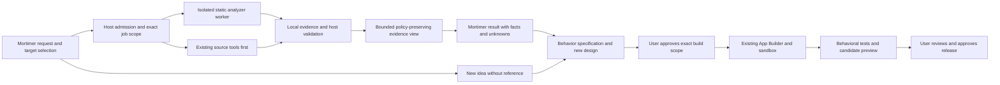

# Mortimer REA app-building integration plan

Date: 2026-10-22
Status: Kimi's bounded NR1 implementation landed via [#283](https://github.com/Larryfix71566/jarvis-voice-ai/pull/283) at merge commit `81b6b4d9e05d5166da4c5809ff6efbc18516d0df`, from immutable implementation commit `d2e7a61d46edcc66bbf1eb5746fb3282a14c7efd`. Post-merge verification on main `075afb18c84a14bca517425f38934eafc92af50d` found unchanged implementation blobs and 81 focused tests passed. Codex owns independent exact-source review, which remains pending. No activation, real app build or acceptance is claimed.
Author: Codex. Independent static NR1 contract review APPROVE at `eb413a25d80df202af8e6d0f04e737ef0463b992`; broader plan review and current reconciliation evidence have distinct scope. See §12 and the preserved review report.
Historical integration base: `ab31dfa8ddf58ad0583afcb25dffd18afbee5765`, containing phone #265 revision 5.2. Candidate branch: `docs/ws31-main-integration-20261022`.
Frozen inputs: REA #245 `b23b824ff15e450fae60535b38a95559eeda9396`; corrected NR1 `eb413a25d80df202af8e6d0f04e737ef0463b992`. Historical phone #240 `87f163a7619596104e27af0bf50a3b6b88d28809` is retained as provenance only; its ancestry and revision-4 WS-30 entry are not adopted.

Historical 2026-10-22 registration (owner/branch superseded by section 13 only after the new handoff lands): this candidate appends only WS-31 after the existing WS-30. On coordinator merge it registers Codex on future `codex/ws31-no-reference-contract-20261022` for exactly the pure module, focused test, synthetic fixture and own documentation/evidence listed in §11/§12. The future implementation branch and source/test/fixture files remain absent. Prior source links retain their recorded immutable revisions; current status and supersession are in §12. Historical statements in §§1–11 and original logs about pending phone dependencies, no publication authority or pending NR1 review describe those earlier slices, not current status. The current dispatch expressly authorizes this documentation draft publication and its required CI, with the coordinator retaining sole merge authority.

## Current evidence and clarified use case

The complete six-page Library research has been retrieved, with 82 body paragraphs and 30 hyperlinks preserved. Source inspection verifies Mortimer already distinguishes `app_builder` for new applications from `developer` for Mortimer self-development. `mcp-apps` exposes creation and build/status/submission operations; `AppWorkspace` delegates actual authoring to the sandbox. The existing technical-plan Skill declares planning/acceptance capabilities, but `compatible_with: []`; portable instruction reuse is verified, while exact REA/app-builder package composition has not been validated. No REA integration, new-app pilot or runtime acceptance was performed.

Larry clarified and confirmed that the purpose is **building new apps and recreating authorized features of existing apps through Mortimer**, not primarily improving Mortimer itself. The research is preserved as originally written; this plan supersedes its Mortimer-self-improvement emphasis for product scope. The focused architecture review verified the reusable instruction baseline with 19 isolated synthetic checks; exact imported-package compatibility and activation remain pre-implementation dependencies. No new registry or control plane is needed for instruction reuse.

## 1. Decision and scope

Use Mortimer's existing App Builder orchestration to turn a user's app idea or authorized reference into an independent implementation. REA is an optional analysis specialist: it investigates reference behavior and packaged artifacts, then supplies evidence and unknowns to a specification. Coding workers build the new app from the approved specification. For a new idea without a reference, start with requirements/design and skip REA; when reference source is available, ordinary source tools are the baseline. **No REA integration is a valid successful outcome** if those paths suffice. Broader binary/runtime analysis is a separately authorized later specialist, never a replacement controller or builder.

The strongest identity match is [morluto/rea](https://github.com/morluto/rea), linked from [rea.tools](https://rea.tools/) and published as `rea-agents`. The user's intended upstream identity remains provisional until confirmed for a pilot. The [complete preserved research](../interface-research/REA_INTEGRATION_RESEARCH_2026-10-22.md) contains every finding and original citation; its [original DOCX](../interface-research/REA_INTEGRATION_RESEARCH_2026-10-22.docx) is unchanged.

**Goal:** a Mortimer-operated workflow from selected outcome/reference → scoped investigation → behavior specification with design choices → independent app implementation → behavioral tests → user review and approved release. Investigation must be inspectable and resource-bounded. Analysis, coding, evaluation, publication and release retain distinct authorities. REA alone is neither a builder nor an application cloner.

**Non-goals:** reconstruct entire proprietary products; recover guaranteed original source; bypass licensing, authentication or access controls; train model weights; replace everyday source search/browser tools; adopt ERA's control plane; expose all REA tools to the Supervisor; run unattended self-modification; change models; conduct live benchmarks; install, enable, deploy, push, merge or open a PR under this documentation task.

The task initially authorized plan/research files only; Larry subsequently explicitly requested appending this app-building plan to the end of the roadmap. This slice therefore adds documentation-only WS-31 and its dated log after pending WS-30, preserving existing priorities, rows and owners. That bounded instruction governs this slice instead of the generic push workflow. No implementation ownership or runtime identifier is reserved. A future implementation requires normal owner/scope registration and separately approved steps; this is not a runtime ownership waiver.

## 2. Options and evidence limits

| Option | When it makes sense | Decision |
| --- | --- | --- |
| Existing planning/source tools only | A new app has no reference, or authorized reference source/tests answer the question | Default and fallback; keep app-building available without REA. |
| Mortimer-owned static adapter and investigation skill | Repeated bundle, version-difference or sanitized-capture questions show additional value | Recommended conditional pilot. The skill explains the workflow; host code enforces authority. |
| Isolated specialist worker | A concrete native/runtime question survives the static pilot's value gate | Later phase; separate OS identity/environment, execution approval and provider acceptance. |
| Embedded engine, fork or ERA workbench | Repeated measured limitations of the public CLI/MCP boundary | Defer. Requires a fresh comparison and maintenance case; no current justification. |

REA's [security policy](https://github.com/morluto/rea/blob/main/SECURITY.md) says it is not a sandbox. Its [MCP contracts](https://github.com/morluto/rea/blob/main/docs/mcp-contracts.md) do not provide per-call approval enforcement; optional HTTP has no TLS/client authentication. Tool annotations and a dedicated process are not containment. Use the public CLI/MCP boundary, with dedicated stdio ownership for any MCP session and no HTTP listener. A reviewed CLI static operation is acceptable for an initial one-shot worker; never expose a free-form CLI or shell to a model.

[ERA](https://github.com/dav1dngy/era-agent) is useful design inspiration for evidence, supervised proposals and rollback. Its [validation matrix](https://github.com/dav1dngy/era-agent/blob/main/docs/SUPPORT_AND_VALIDATION.md) discloses unverified real Claude Code integration, mocked multi-agent coverage and incomplete self-evaluation. It is not evidence of a validated Mortimer harness replacement. The preserved report also covers Reconstruction Companion, the distinct Rust REA, GhidraMCP and exact-name alternatives; none was independently benchmarked here. Do not install a companion skill into upstream REA's canonical skill files.

Research reported REA 6.7.0 and specific Node requirements on 2026-10-22. Those are historical observations, **not an approved dependency pin**. A tag, repository main, npm tarball and installed binary are separate identities. Client handshake, provider doctor and mocked tests do not prove target-specific accuracy or model compatibility.

## 3. Existing Mortimer integration seams

These are source observations at the baseline above, not claims that the installed app has accepted them. The existing installed checkout was observed at detached `b136a2a…` with local changes; it was not modified. No running-process or deployed-build verification was attempted in this task.

| Seam and pinned source | Reuse and constraint |
| --- | --- |
| [Supervisor/delegation](https://github.com/Larryfix71566/jarvis-voice-ai/blob/f88f5f56d4b34bd35007f964dcc4047318144478/jarvis/agents/delegate.py), [agent grants](https://github.com/Larryfix71566/jarvis-voice-ai/blob/f88f5f56d4b34bd35007f964dcc4047318144478/config/agents.yaml) | Keep the Supervisor a dispatcher. An asynchronous investigation produces evidence outside the voice path; no broad Developer capability grant. |
| [App Builder tools](https://github.com/Larryfix71566/jarvis-voice-ai/blob/f88f5f56d4b34bd35007f964dcc4047318144478/mcp_servers/mcp_apps/logic.py), [AppWorkspace](https://github.com/Larryfix71566/jarvis-voice-ai/blob/f88f5f56d4b34bd35007f964dcc4047318144478/jarvis/agents/workspace.py#L75), [sandbox workspace](https://github.com/Larryfix71566/jarvis-voice-ai/blob/f88f5f56d4b34bd35007f964dcc4047318144478/sandbox/workspace.py) | New apps belong to `app_builder`, separate from Mortimer `developer`. Actual code writes use the sandbox; `app_write_file` is retired despite older agent-description wording. Existing start confirmation covers draft-PR submission after validation. A local-only preview must not call that publishing workflow unless that scope is explicitly authorized; a narrower non-publishing mode is a design dependency. |
| [Planning Skill](https://github.com/Larryfix71566/jarvis-voice-ai/blob/f88f5f56d4b34bd35007f964dcc4047318144478/skills/technical-plan-document/SKILL.md), [manifest](https://github.com/Larryfix71566/jarvis-voice-ai/blob/f88f5f56d4b34bd35007f964dcc4047318144478/skills/technical-plan-document/mortimer.yaml), [app-build host](https://github.com/Larryfix71566/jarvis-voice-ai/blob/f88f5f56d4b34bd35007f964dcc4047318144478/jarvis/admin/server.py) | Reuse evidence-first planning and acceptance artifacts. Sequential host handoff is preferred over assuming simultaneous Skill composition; exact package matcher/grant/role compatibility and artifact admission remain pending; the focused review already verifies portable instruction reuse. Do not assume the existing `plan_path` string supplies immutable specification binding. |
| [Registry and environment scoping](https://github.com/Larryfix71566/jarvis-voice-ai/blob/f88f5f56d4b34bd35007f964dcc4047318144478/jarvis/skills/registry.py#L262) | Existing MCP supervision and server grants are reuse points, not a ready-made REA sandbox. `build_child_env` has a full-inheritance escape flag; the proposed analyzer must independently refuse unsafe inheritance and use an empty/explicit environment and isolated home. No credentials, auth sockets or personal profiles. |
| [Skill pins](https://github.com/Larryfix71566/jarvis-voice-ai/blob/f88f5f56d4b34bd35007f964dcc4047318144478/jarvis/agent_skills.py#L189), [selection](https://github.com/Larryfix71566/jarvis-voice-ai/blob/f88f5f56d4b34bd35007f964dcc4047318144478/jarvis/skill_selection.py) | Later use native Skills manifest/references, package digest and capability checks. Present installed, enabled, loaded and callable separately. A written skill is neither activation nor enforcement. |
| [Privacy/source envelopes](https://github.com/Larryfix71566/jarvis-voice-ai/blob/f88f5f56d4b34bd35007f964dcc4047318144478/jarvis/privacy_policy.py), [model execution](https://github.com/Larryfix71566/jarvis-voice-ai/blob/f88f5f56d4b34bd35007f964dcc4047318144478/jarvis/model_execution.py) | Preserve host-issued source provenance and inherited data policy before reasoning. Untrusted tool output cannot classify itself as public or select a route. Use the existing execution boundary, not an SDK hidden in the REA adapter. |
| [Run evidence](https://github.com/Larryfix71566/jarvis-voice-ai/blob/f88f5f56d4b34bd35007f964dcc4047318144478/jarvis/runlog/store.py), [notices](https://github.com/Larryfix71566/jarvis-voice-ai/blob/f88f5f56d4b34bd35007f964dcc4047318144478/jarvis/notices.py) | Correlate request/job/run/evidence identities; send bounded status to the originating result. Best-effort telemetry is not a substitute for mandatory authorization/evidence receipts. |
| [Daily collector](https://github.com/Larryfix71566/jarvis-voice-ai/blob/f88f5f56d4b34bd35007f964dcc4047318144478/jarvis/status/daily.py#L71) | Current dependency construction includes subscription/key probes. A passive brief may summarize already-approved results only; do not invoke this collector unchanged or schedule fresh analysis through it. |
| [Evaluation budgets](https://github.com/Larryfix71566/jarvis-voice-ai/blob/f88f5f56d4b34bd35007f964dcc4047318144478/jarvis/skill_evaluation.py), [review](https://github.com/Larryfix71566/jarvis-voice-ai/blob/f88f5f56d4b34bd35007f964dcc4047318144478/jarvis/skill_evaluation_review.py) | Reuse frozen fixture identities, caps and review patterns. Existing skill fixtures are not REA acceptance, and synthetic data does not make a live model call offline. |
| [Model preferences](https://github.com/Larryfix71566/jarvis-voice-ai/blob/f88f5f56d4b34bd35007f964dcc4047318144478/jarvis/model_preferences.py#L98), [native Repo panel](https://github.com/Larryfix71566/jarvis-voice-ai/blob/f88f5f56d4b34bd35007f964dcc4047318144478/macos/MortimerHost/Sources/MortimerHost/Drawer/RepoTab.swift) | Reuse the controller owner's exact-proposal confirmation work. Current profile-based staging does not itself prove immutable model binding or runtime adoption. REA must not implement another selection or approval service. |
| [Creator requests](https://github.com/Larryfix71566/jarvis-voice-ai/blob/f88f5f56d4b34bd35007f964dcc4047318144478/jarvis/skill_requests.py), [self-edit proposals](https://github.com/Larryfix71566/jarvis-voice-ai/blob/f88f5f56d4b34bd35007f964dcc4047318144478/jarvis/selfedit/proposals.py), [verifier](https://github.com/Larryfix71566/jarvis-voice-ai/blob/f88f5f56d4b34bd35007f964dcc4047318144478/sandbox/verify.py) | Route later authorized authoring to existing isolated development and independent verification. Existing human-only paths stay human-only. VM availability does not establish suitability for arbitrary hostile samples. |

Read-only coordination used the Skills architecture owner and WS-05 controller/skill/brief/approval owner, including its 2026-10-22 checkpoint and candidate `mortimer.harness-model-management.v1` contract. The [controller owner draft #242](https://github.com/Larryfix71566/jarvis-voice-ai/pull/242) owns model experiments; do not copy its numerical trial counts into this plan because they have changed across revisions. Neither related task's review constitutes review of this REA plan. Their artifacts and implementation candidates remain separately owned and are not imported here. Phone workflow parity must consume the same eventual host proposal IDs, not create another approval path.

### Verified instruction reuse and remaining package work

Importer design is owned by the coordinated **`mortimer.skill-compatibility.v1`** planning contract under WS-03. Reuse its pipeline: source snapshot → compatibility inventory → disabled candidate → offline evidence → explicit exact activation → runtime readback. This plan specifies REA capability needs and consumes that contract; it does not define another importer. The completed shared-contract handoff (original version 0, 15-page presentation), published as an addendum to the canonical WS-03 plan by the companion synchronization draft, remains a proposal, not an implemented activation service. Its canonical adoption target is the existing [WS-03 Skills Workspace plan](MORTIMER_SKILLS_WORKSPACE_IMPLEMENTATION_PLAN.md); the original append-only patch was unapplied at authoring; the companion draft proposes its sanitized content in that existing plan without authorizing implementation. The handoff includes a 22-row gap matrix and 25 proposed acceptance cases. Exact source document `SKILL_COMPATIBILITY_PLAN.md` SHA-256: `b24348627db0ec2dbeff12e8392662f68db9fbc51a7e077dd26832aaeac1fa29`. W1 must consume this exact contract or a later explicitly reconciled revision. Unknown required behavior or execution/security semantics block activation; descriptive metadata may be retained with visible noninterpretation. Scripts/services require separately approved tool integration and never gain authority from `SKILL.md`.

The architecture owner's `MORTIMER_SKILL_REUSE_VERIFICATION.md` (2026-10-22) and `SKILL_REUSE_PROOF.json` report **19 passing isolated checks** of real loader/catalog/selector/resource functions with synthetic temporary inputs. The proof forbids network, subprocess and SQLite activity. Its installed-source baseline is `b136a2a`; the report verifies shared loader machinery in inspected main `f88f5f5` and provider candidate `574282e`. These are focused function checks by the architecture task, not this plan's independent review, live trigger accuracy or REA acceptance. Report SHA-256: `38b4d40467b77219b73649cf04f2c2f7cf6add46e48a093ba4d3c5a03b416dc5`; proof SHA-256: `f73a0c599dc39113c5d1673f5b6d3a397ea99f2bb46bf88cd138165359f0fd9c`.

- Compatible registered `SKILL.md` instructions can be reused unchanged. Use the existing registry; V2 additionally requires a Mortimer metadata sidecar, readiness/capability/privacy checks and an exact package digest. Do not rewrite reusable knowledge merely to introduce REA.
- Declared Markdown/text references are reusable through [the pinned resource reader](https://github.com/Larryfix71566/jarvis-voice-ai/blob/f88f5f56d4b34bd35007f964dcc4047318144478/jarvis/skill_resources.py). Arbitrary links do not declare resources; scripts, binary assets, plugin services and host-specific behavior are not automatically provided by the loader. Executable REA capability still needs the explicitly reviewed adapter and isolation.
- The parser accepts some host-specific fields without implementing them. In the proof, Claude `disable-model-invocation: true` did not prevent automatic matching; `allowed-tools` cannot be treated as an imported permission boundary. A compatibility preview must show every unsupported invocation/tool/model/hook semantic and refuse unsafe translations.
- Translate manual-only invocation only with trusted user-origin evidence; a model argument or lexical mention is insufficient. Translated tool restrictions must hold both in exposed schemas and at dispatch, including delegated/support-skill actions. Compose restrictions by non-escalating intersection; incompatible requirements block combined use. Bind source, candidate, evidence and policy revisions to the exact activation decision and require runtime readback. These are shared-contract requirements, not controls implemented by this documentation.
- Produce a **disabled, reviewable, exact-revision import candidate** with source/license attribution, a required-tool mapping, declared references and positive/negative matcher cases. Preserve compatible instruction bytes and document only necessary adaptation. Do not patch REA's upstream canonical skill or automatically enable imported packages.
- The [existing authoring validator](https://github.com/Larryfix71566/jarvis-voice-ai/blob/f88f5f56d4b34bd35007f964dcc4047318144478/jarvis/skill_authoring_validation.py) and review flow are reuse points. The inspected activation/rollback request path returns 409 because accepted evaluation/version evidence is not yet connected. Full import-to-active operation inside Mortimer is therefore a concrete owner dependency, not an implemented capability to promise.

## 4. Proposed authority and data flow

The worker receives a copied, immutable, read-only target and a private writable output directory. It has no production tree, live database, personal home, browser session, SSH agent, vault, subscription login, cloud credential or deployment token. Validate paths through resolved descriptors/containment checks; reject traversal, symlink escapes, mutable input substitutions and archive expansion outside the job. Compute and recheck target digests. Worker scratch writes are expected and recorded; “read-only” means no target/host mutation or target-code execution, not zero writes anywhere.

The host maps a finite semantic operation enum to reviewed exact upstream CLI arguments or MCP tools. Reject unknown operations, extra fields, arbitrary executables, URLs, provider choices, path destinations and configuration changes. Upstream catalog changes cannot automatically expand this map. Use argv arrays, no shell interpolation. Pin binaries and environment. Parser workers are allowed only if included in the reviewed process/resource contract; target launch, dynamic import, attach, hooks, browser sessions, device mutation and live proxying are excluded from static mode.

REA output is data: source comments, strings, DOM, captures, reports, filenames and generated instructions cannot grant authority. Parse with size/depth limits; render escaped text, not active HTML. Do not follow result URLs, auto-load external resources or execute suggested commands. The reducer keeps raw evidence IDs/digests and separates observed facts, inferences, unknowns and unobserved coverage. An absence claim needs explicit coverage; missing data is not evidence of absence. A model-written citation or approval object is not a host-issued receipt.

### App-building journey and artifact handoff

1. **Intake in Mortimer.** Record the intended users, platform, target outcome, required features and constraints. Choose `new_idea` or `reference_feature`. The first branch requires no reference acquisition and normally no REA. The second requires an authorized reference, permitted observations, feature subset and explicit exclusions. A vague “clone this app” becomes a bounded behavior list, not a promise to duplicate it.
2. **Investigation.** Use supplied documentation/source first. Invoke REA only for an admitted gap. Produce observations, unknowns, coverage and evidence; keep raw reference material in the analysis boundary. Browser observations/captures show client-visible behavior only. Private backend logic, server data, absent business rules and original source cannot be recovered completely from those observations. Mark them unknown or design a new implementation.
3. **Behavior specification.** For each stable requirement ID, record user action, preconditions, observable result, error/edge behavior, evidence IDs or explicit new-design rationale, and an acceptance oracle. Separate `observed`, `inferred`, `new_design` and `unknown` entries. Larry resolves blocking unknowns or accepts a clearly labeled substitute; unanswered questions never become invented facts.
4. **Independent design and implementation.** The App Builder receives the approved behavior specification, approved dependencies and permitted original/openly licensed assets. It does not receive a general instruction to copy source, proprietary imagery, branding or layouts wholesale. Reuse code/assets only with explicit rights and recorded attribution. A separate model session alone does not establish a legal clean room. Build the smallest complete feature slice with the existing sandbox worker and admitted project profile.
5. **Behavioral verification and preview.** Map each requirement to deterministic tests, fixture/manual observations and actual results. Compare the new app to the approved behavioral requirements; a screenshot resemblance or successful compilation is insufficient. Distinguish intentionally changed design from a mismatch. Keep holdout cases and independent scorer/oracle ownership where applicable. Preview the candidate inside Mortimer with evidence, limitations, asset/dependency notices and diff/build identity.
6. **Review and release decision.** Larry reviews exact candidate/source/spec/test digests and the intended destination. Approval to inspect a reference is not approval to create a remote repo, publish a draft PR, merge, sign, distribute or deploy. Existing app-build start approval can include a draft PR only when the preview explicitly names that scope; otherwise require a host-enforced non-publishing path before build execution. Release remains a separate exact, recorded decision. Show published, installed and behaviorally accepted as different states.

The host owns one artifact chain: intake → evidence → specification → build candidate → evaluation → release proposal. Every artifact references its parent's digest and owner/request ID. Revising evidence, requirements, dependencies or target platform invalidates downstream approvals. Analysis output cannot mutate the specification silently. The worker gets only approved inputs and its finite capabilities; no general release token. If compatibility with existing Skills/host APIs is unresolved, stop at the completed artifact and show the handoff as pending.

## 5. Proposed typed contracts

These are Mortimer design fields, **not assertions about upstream REA schemas**. The implementation owner must freeze a versioned JSON schema, reject additional properties and publish the exact mapping before a pilot.

| Request group | Required semantics |
| --- | --- |
| Host identity | `schema_version`, host-issued `job_id`, originating request/owner, admission receipt, expiry and idempotency key. The model supplies only the question and an already admitted target reference. |
| Target | `target_ref`, content digest, byte/file counts, authorized inspection purpose, immutable snapshot identity and data classification. Resolve filesystem locations host-side. |
| Scope | `question`, `analysis_mode` limited initially to static, approved semantic operation set, dependency/provider pin and schema digest. No arbitrary upstream tool name. |
| Limits | Wall time, CPU, memory, input/expanded bytes, output bytes, process count, evidence retention and model-call budget. `network=denied` and `target_execution=false` are enforced policy, not editable model arguments. |
| Storage | Host-allocated private job root, read-only input and separate output/evidence namespace. Caller cannot supply an unrestricted output path. |

| Response group | Required semantics |
| --- | --- |
| State | `completed`, `partial`, `unsupported`, `refused`, `failed`, `cancelled` or `cleanup_pending`; errors have stable codes. A success flag cannot conceal missing evidence. |
| Findings | Facts with file/offset/line or capture-entry locations; separately labeled inferences and unknowns; inspected coverage; immutable evidence references and hashes. |
| Provenance | Target/adapter/upstream/provider/schema/fixture identities; approved versus actual operation set; exact host/OS/tool versions; start/end times. |
| Effects and resources | Observed processes, file effects, network policy evidence, elapsed time, peak resource use, output size; accounting completeness and measurement method. |
| Cleanup | Owned-process termination/drain, output disposition, retained evidence, expiration and any residual state. Cleanup not verified means no completed-clean claim. |

Use host state transitions: admitted → queued → running → evidence validation → terminal. Cancellation records intent immediately, stops new work, terminates the owned process group within a finite deadline, drains/reconciles workers and rejects late results. If termination or cleanup is uncertain, retain a quarantined record and show `cleanup_pending`; never retry automatically against a possibly still-running job. Restart reconciliation must not relaunch jobs without fresh admission. General durable task recovery is a parked roadmap proposal, so a minimal explicit interrupted-job state is required rather than assumed infrastructure.

Additional versioned host artifacts must bridge analysis to the existing builder. These logical contracts do not reserve new endpoint names or require a second orchestration service:

| Artifact | Minimum fields and admission rule |
| --- | --- |
| `AppIntent` | Owner/request ID, `new_idea` or `reference_feature`, platform, user outcome, feature boundaries, reference rights/scope if any, approved assets and constraints. No target is acquired from an arbitrary model URL. |
| `BehaviorSpec` | Spec version/digest, parent intent/evidence digests, requirement IDs, observed/inferred/new-design/unknown classification, acceptance cases, unresolved blockers, dependency/asset policy and user disposition. Builder refuses missing approval or blocked unknowns. |
| `BuildRequest` | Exact spec digest, admitted app identity/repository/base ref, sandbox profile, tool/route/resource policy, build authorization and publication scope. Host binds imported spec bytes to the digest instead of trusting a mutable `plan_path`. |
| `BuildCandidate` | Source commit/tree or immutable archive digest, spec digest, lockfile/assets inventory, build outputs, permitted side effects and limitations. Never infer that a repo exists from a proposed name. |
| `BehaviorEvaluation` | Candidate/spec/fixture digests, every requirement ID and pass/fail/unknown/not-tested result, evidence, environment, scorer, resource usage and coverage. Unchecked requirements cannot be counted as passing. |
| `ReleaseProposal` | Exact candidate and evaluation identities, destination, publication/installation actions, notices, rollback/removal and expiry. Host-issued confirmation consumes one exact proposal; the builder/analyzer cannot approve it. |

Use sequential bounded handoffs with the current controller and App Builder. Do not create a new always-running agent merely because an artifact contract is new. Using the verified reuse baseline below, the implementation compatibility pass must settle whether one amended Skill or several sequential existing Skills best express these stages, and verify exact matcher/role/capability pins.

## 6. Privacy, dependencies and cost

Before any installation, record official owner/package identity, exact release and commit, npm integrity digest, lockfile/transitive versions, required Node version, platform support and checksums for additional engines. Review install/lifecycle scripts, optional downloads, update checks, telemetry, local listeners and process spawning. Produce a dependency/license inventory and a removal procedure. Review REA's MIT terms plus [third-party notices](https://github.com/morluto/rea/blob/main/THIRD_PARTY_NOTICES.md); native engines and inspected targets have separate rights and license conditions. Do not preinstall a full native toolbox or modify global coding-agent configuration. Unresolved provenance or license requirements block acquisition.

Start with public, owned synthetic fixtures. Preserve the strictest input classification through extracted evidence, summaries, logs and model prompts. Only selected, checked excerpts may reach an approved reasoning route; do not send full captures, application graphs or personal logs. Keep evidence private with restricted permissions and a finite retention policy. A proposed pilot default is deletion of raw job data after seven days or sooner on request, retaining content-free provenance and decision receipts only under existing policy. Product retention/erasure requirements win; deletion must invalidate dependent evidence views and proposals. No automatic knowledge-base ingestion.

Direct paid OpenAI and Anthropic APIs are excluded. Supported subscription-authenticated clients may later reason outside the analysis sandbox over admitted excerpts, if the exact account/workload, capabilities, quota and overage settings are approved. Do not extract subscription credentials into custom SDKs. Other provider APIs, including OpenRouter or SAYGM, remain possible only under their own actual eligibility, privacy and cost policy. A provider being allowed in principle is not proof the current route supports it. No silent fallback, model change or new live benchmark is authorized. A static fixture pilot uses **zero model calls**; any later comparative model run belongs to the controller owner's separately authorized plan.

Proposed initial test envelope: one concurrent job; 25 MiB input and 100 MiB expanded input; 250 MiB output; 2 GiB memory; at most two CPU cores; 120 seconds wall time per job, ten minutes total per fixture batch. These are reviewable ceilings, not measured requirements or permission to run. The isolation owner must demonstrate enforcement, including descendants and disk exhaustion; unavailable hard limits make the environment ineligible. Stop at a ceiling and report partial/unsupported; do not silently raise it. Model allowance is zero in phases 0–2. Later caps must account for every started request and uncertain cancellation, not just successful responses.

## 7. Phases and go/no-go gates

### Phase 0 — scope and dependency decision

**Current authorized work:** preserve research, inspect architecture and write this plan. All subsequent phases are proposals.

For a later decision, identify the intended official REA project, one recurring practical question and an owned artifact with a known oracle. Record what source tools already answer, expected user benefit, target rights/classification and maintenance owner. Name the adapter, isolation and independent acceptance reviewers; they are unassigned today. Prepare exact acquisition/removal and resource proposals. Keep release work ahead of this enhancement.

**Gate G0:** Larry accepts the use case, owner assignments and bounded acquisition/implementation scope; dependency identity and rights are resolved. If source tools suffice or no meaningful gap exists, choose no integration and retain this research. No install follows from approval of the document alone.

### Phase 1 — host contracts and offline enforcement

After explicit implementation authorization, build a narrow adapter around a fake analyzer first, with no upstream install or model service. Create host admission, scoped storage, schema validation, effect receipts, cancellation and safe error presentation. A prospective native Skill remains a candidate; existing config/skill enablement and human-only allowlists are untouched unless separately approved by their owner.

Test the cases in section 8 before running an actual parser. Reuse existing privacy, registry, request and evaluation patterns; do not add a second policy engine or silently expand server grants. Exact operation mapping and process behavior are reviewed against the subsequently pinned upstream version.

**Gate G1:** all mandatory denial, source-binding, budget, cancellation and cleanup tests pass with inspectable receipts. No effect or provider call escapes the fake boundary. Independent review must cover the real adapter/launcher and OS restrictions before actual parser use. An unresolved containment issue stops the phase.

### Phase 2 — bounded static fixture pilot

Requires a separate approved pinned install in a disposable environment, G1, and explicit permission to execute the selected static parser operations. No live model calls, target application launch, network capture collection or native engines.

| Pilot | Known truth and questions | Acceptance evidence |
| --- | --- | --- |
| A: tiny owned JavaScript/Electron fixture | Three fixed questions: UI action → IPC channel, IPC handler → function, and an intentionally unresolved dynamic target | Compare ordinary search/AST against static REA on the same bytes. Correct locations and honest unknown; no execution of application code. |
| B: owned source plus built artifact, two versions | Three fixed questions: selected source/bundle relationship, one intentional behavior change, and unchanged control behavior | Build fixture ahead of the analysis run under a separately approved process. Include source maps only when declared; no regeneration during analysis. Independently check every answer against the oracle and both digests. |
| C: optional sanitized HAR/SAZ capture | Recorded request/response behavior and one missing/ambiguous field | Only if a real capture-debugging need exists. No URL fetching, proxy, root certificate, credential or unrelated traffic. Confirm sanitization and no egress. |

Freeze questions/oracles and evidence requirements before comparing. Report correct, incorrect, unsupported and unknown answers separately; keep all attempts and setup time. Repeat deterministic analysis three times per admitted fixture if it fits the batch cap, recording reproducibility and timing range. Small fixture results establish only these cases, not generalized accuracy or p95 latency.

**Gate G2:** all six material A/B answers are correct or the oracle-required explicit unknown, all material findings have retrievable evidence, and all security/cleanup gates pass. To justify expansion, REA must either correctly answer at least one predeclared artifact question that baseline tools cannot answer, or reduce measured analyst effort by a pre-agreed meaningful threshold (proposed 20%) on a recurring question without losing correctness. Count setup, review, cleanup and expected maintenance; do not conflate machine runtime with human effort. If the result is too small or ambiguous, mark inconclusive and stop or request a narrowly defined new trial. If no additional value appears, choose no integration. No live reasoning run is needed to make that decision.

### Phase 3 — Mortimer-native static investigation

Requires G2 evidence, explicit product integration/installation/enablement approval and coordination with existing Skills, provider and approval owners. Add an in-app flow: choose admitted target and question → preview scope/privacy/resources → start → inspect status/cancel → view evidence, inferences and unknowns → review a behavior specification and request an independent app build. Do not require Larry to operate a terminal or a second workbench.

Reuse the originating request's result area and established placement rules. A passive brief may link to existing finished findings but cannot launch jobs, probes, model comparisons or confirmation operations. Keep analysis outside the voice critical path and pause background work under resource pressure. An analyzer crash must not stop ordinary Mortimer use.

Any proposed patch needs exact source revision, patch digest, evidence, validation gaps and an independent review path. Bind a user decision to the immutable proposal, owner, expiry and current state; reject replay, changed target/configuration and a model-generated “yes.” Never let the analysis producer approve its own proposal. Separate permission to investigate, author code, run evaluations, apply, publish and activate. Existing human-only restrictions still apply; full in-app application requires the owning team's trusted host action, not a prompt bypass.

**Gate G3:** the existing activation-request gap is completed by its owning team with accepted revision/evaluation evidence; offline integration/UX contracts and authorized physical app acceptance pass; status is truthful, cancel works, sources remain scoped, current voice behavior is preserved, and enabled/loaded/callable state is verified. Any later model comparison or acoustic performance trial requires its own authorization and the controller owner's evaluation contract. Saving configuration alone does not prove runtime adoption.

### Phase 3B — app-building slice and release preview

The no-reference branch can develop after W1/W2 plus the app-builder compatibility/approval review and applicable host-only G1 checks for identity, privacy, budget and cancellation. REA acquisition, launcher tests and G2 are not prerequisites for that branch; record them as not applicable. The reference-assisted branch additionally requires G2/G3. Both require explicit coding/evaluation scope and a verified builder route; this documentation task authorizes neither. Use the current `web-app` sandbox profile as the first proposed target because `AppWorkspace` already defaults to it. Native desktop/mobile targets require a separately reviewed profile, toolchain and acceptance design.

Deliver one small owned app slice, such as filtering and exporting a synthetic list. For the reference-assisted case, use an owned fixture with known behavior; reproduce the behavior using independent code/assets. The new-idea case uses user-approved requirements with no reference. Include missing-backend behavior, one deliberate new-design choice and an unavailable feature, so Mortimer demonstrates honest boundaries rather than merely matching a happy-path screen.

**Gate G3B:** every approved must-have requirement has a passing, inspectable case; non-goals and unknowns are visible; source/dependency/asset provenance is recorded; build and reference environments are separate; denied publication/release produces zero remote mutations; changing the spec or candidate invalidates approval. A user can inspect, reject, revise and cancel entirely within Mortimer. Test the existing draft-PR scope and any new local-only mode with fake publication clients before authorized live use. No real repo creation, PR, merge or release is required to pass offline contract tests. Actual distribution remains a separate decision, even after a correct app preview.

### Dependency-ordered implementation work packages

All work is future/unstarted. Roles below are proposed responsibilities, not assignments. Each item yields a concrete artifact and one independently checkable gate; the implementation dispatcher must name owners and exact paths before coding.

| Item | Depends on | Deliverable and proposed reuse | Completion evidence |
| --- | --- | --- | --- |
| W1 — compatibility and scope | G0 | Consume shared `mortimer.skill-compatibility.v1`; inventory App Builder, planning Skill, selector pins, sandbox profile and action/publication semantics; rights/use-case record; no-reference/reference decision | Source-referenced compatibility matrix and exact shared-contract revision; each seam supported or explicitly blocked; no second importer/control plane. |
| W2 — immutable artifact contracts | W1 | JSON schemas for section 5, host-issued identity and digest binding; fixture-only intent/spec/build/release artifacts | Offline schema tests reject changed parents, owner mismatch, unknown fields and forged approval. |
| W3 — static adapter and containment | W2 | Fake analyzer, finite operation mapping, isolated launcher, evidence reducer, cancellation/removal receipts | G1 matrix passes; independent adapter/isolation review completed before upstream execution. |
| W4 — pinned fixture pilot | W3, scoped dependency approval | Acquisition manifest, owned A/B fixtures, baseline and REA receipts, no-integration decision option | G2 correctness/value/containment evidence; no live model or target execution. |
| W5 — Mortimer investigation UI | W4, Skills/Console owner coordination | Intake/scope preview/status/cancel/evidence view, candidate Skill with verified matcher behavior | G3 acceptance, including unsupported/cleanup-pending states and no incidental probes. |
| W6 — specification-to-builder handoff | W2; W5 for REA branch | Approved `BehaviorSpec` admitted into existing AppWorkspace; exact build/publication authorization; local-only mode if required | No-reference path works with REA unavailable; reference branch rejects stale evidence/spec; fake remote client observes zero unauthorized writes. |
| W7 — independent build and behavior evaluation | W6, separately approved coding route | One app slice, original/licensed assets, dependency inventory, requirement/test matrix and candidate preview | G3B coverage; incorrect, untested and unknown outcomes remain distinct; repeatable build/profile evidence. |
| W8 — release proposal and product acceptance | W7, release owner | Exact candidate/destination proposal, decision receipt and rollback/removal plan; later authorized distribution | Rejection/replay/candidate drift blocks release; authorized release has destination and artifact receipt; installed/accepted state separately verified. |
| W9 — optional runtime/native specialist | W4–W8 with repeated unresolved need | New target-specific isolation/provider plan and amended operation contract | G4 plus separate installation/execution/attach approval; no automatic expansion. |

W2/W6 can exercise the no-reference branch using fake workers before W3–W5. Actual coding, model use and external writes still require their own authorization. Implementation and acceptance owners must integrate with WS-22 investigation artifacts and WS-24 recovery only when those foundations exist; neither parked plan is an available service today.

### Phase 4 — isolated runtime/native specialist, only if justified

Requires recurring unanswered cases, successful G2/G3 value evidence, a fresh threat assessment and separately approved target execution/attach. Use a disposable appropriate OS environment; macOS GUI/native targets may require a Mac VM, not an assumed-equivalent generic container. Select a licensed provider and exact engine/client/extension matrix. No personal browser profile, host mounts, clipboard/audio/device access or network unless specifically justified and scoped by the new approval. Keep the reasoning client's credentials outside the target environment.

**Gate G4:** target-specific provider accuracy, actual OS boundary enforcement, process/resource containment, cancellation, teardown and independent review pass. Live/decompiler/GUI capability health alone does not pass. Broader capabilities remain disabled on uncertainty. A fork or embedded engine requires a new plan justified by documented public-boundary failures; it does not follow automatically from this phase.

## 8. Required offline regression and acceptance matrix

All rows below are future required checks, not results from this documentation task.

| Family | Required cases and pass condition |
| --- | --- |
| Admission and filesystem | Unauthorized target, traversal, symlink/archive escape, digest substitution, read outside copied input, write to target/host, owner mismatch and stale authorization all fail before effects. |
| Network and secrets | DNS/HTTP attempts, redirects, loopback access, secret-shaped capture data and inherited credential/profile/socket variables; denied egress and no secrets in model-visible output or logs. Demonstrate with host observation, not analyzer claims. |
| Prompt injection | Comments/strings/DOM/report text requesting shell, new tools, policy edits, route changes or autoapproval; no expanded capability and no execution. Forged source classifications/receipts are rejected. |
| Contract and output | Unknown tool/field, malformed/oversized/deep output, schema drift, active HTML and citation outside the admitted evidence set; fail closed with bounded diagnostics. |
| Resources and lifecycle | Parser hang, descendants, crash, output/disk expansion, repeated cancellation, late output and interrupted host; enforce ceilings, reject late publication, verify owned-process drain and residual files. |
| Accuracy and coverage | Known A/B oracles, unsupported format, removed symbol, dynamic ambiguity and version control; no invented locations or “not present” from unobserved data. |
| Approval and policy | Replayed/expired/changed proposal, concurrent confirmation, producer selfapproval and unavailable subscription; no mutation, model switch or hidden API fallback. |
| Product resilience | Analyzer unavailable, interrupted/reopened result, passive brief and scoped evidence deletion; ordinary voice remains functional, no incidental probes/inference and no falsely completed job. |
| App-building branches | New idea with no reference succeeds through planning without REA; supplied source uses source tools; reference-only package uses admitted analysis; unavailable private backend remains unknown or a user-approved new design. |
| Specification and rights | Observed behavior, inference and new design remain separately labeled; missing rights/asset permission blocks transfer; protected assets/code never appear in the builder inputs without explicit reuse rights. Every must-have has an oracle. |
| Build and release | Wrong app/base, modified spec, changed dependency, failed test, cancelled build, duplicate publication and stale candidate approval all prevent release. Preview-only permission cannot invoke draft-PR submission or repo creation. |

Candidate test homes are the existing offline `tests/unit/` and MCP wiring `tests/integration/` conventions, with dedicated versioned fixtures under `tests/fixtures/` after scope registration. Reuse source-envelope tests, registry isolation tests, skill-evaluation budget/review tests and request cancellation checks. Native acceptance follows existing Skills/Console contracts. Do not run full live suites, daily probes or model-access verification as documentation checks.

Every pilot receipt must name approved scope, code/package/engine/schema/host identities, target and fixture hashes, baseline method, exact operations, expected/actual answers, evidence locations, unknowns, elapsed/resource measurements, zero-or-authorized model usage, filesystem/network observations and cleanup outcome. Include failed attempts and limitations. Require evidence completeness before declaring success.

## 9. Failure, disablement and removal

Fail closed for missing policy, pin, authorization, isolation or source provenance. Return a useful reason in Mortimer and preserve the source-tools path. Do not auto-retry across changed inputs or an uncertain cleanup state. Existing critical voice services must not depend on the analyzer being available.

Before activation, record exact prior skill/configuration state and provide an owned disable switch, queue drain, process termination and scoped uninstall procedure. Remove only the pinned job environment/cache and owned evidence according to retention; never delete shared provider installs or user targets. Verify no listener, process, login item or global agent configuration remains. Re-enabling a different version requires new pin/contract validation. No database restore is needed to remove an analysis adapter; do not roll back unrelated user data.

Any code/config rollback is a separate exact proposal through the existing owner, unless an already-approved atomic transaction explicitly includes return to its exact pre-state. No model fallback, service restart or release operation is implied by a cleanup failure.

## 10. Progress and remaining decisions

**2026-10-22 — documentation slice:** retrieved the complete Library DOCX through supported Library access; preserved original bytes and all body text/hyperlinks; inspected AGENTS.md, documentation map, architecture/repository references, allowlist sequence and current roadmap; fetched main into a separate local clone and created this isolated documentation worktree. Read the two related owners' artifacts without changing their work. The user then clarified app-building scope and authorized an end-of-roadmap intake; WS-31 is appended after inherited pending WS-30. No REA installation/execution, live model call, benchmark, configuration change, push, PR, merge or activation.

Documentation validation: exact DOCX byte equality/SHA-256 and all 82 body paragraphs/30 hyperlink occurrences preserved; local Markdown/source references and pinned Mortimer paths checked; strict roadmap checker reports zero errors/warnings before and after the append; prior roadmap bytes and phone documentation are preserved; whitespace/diff scope checked. Critical upstream policy/contract/validation URLs were accessible, but not every external link was independently revalidated. These checks do not validate the proposed integration or confer independent review.

Next decisions: confirm intended REA project and concrete first question; choose no integration or authorize a bounded G0/G1 proposal; assign implementation, isolation and independent acceptance owners; approve exact dependencies/rights, enforceable budgets and retention. Installation, actual parser execution, app enablement, live evaluation and any broader execution remain separate checkpoints. Until those decisions, keep this plan proposed and local. The roadmap records planned work, not approval to implement.

Open decisions for implementation dispatch:

1. **First app outcome:** a new idea or an owned reference feature. Recommend the smallest complete web-app feature with a deterministic oracle. The new-idea branch needs no REA identity or dependency decision.
2. **Reference and dependency identity:** confirm `morluto/rea` and the exact immutable release/package/engine matrix only if analysis is needed. Recommend static JavaScript first; unresolved provenance blocks acquisition.
3. **Skill packaging:** consume the completed version-0 `mortimer.skill-compatibility.v1` handoff linked above (or an explicitly reconciled later revision) and inspect the exact chosen package. Prefer unchanged compatible instructions plus native metadata and explicit adapter binding; do not presume scripts or host invocation rules transfer.
4. **Build publication scope:** either explicitly approve the existing build-through-draft-PR workflow or require an owner-reviewed local-only mode. Recommend a non-publishing first acceptance slice; do not call the existing publishing path under preview-only authority.
5. **Owners and operational envelope:** name implementation, isolation and independent acceptance owners; approve or revise the proposed caps/retention with evidence. No actor is assigned by a suggested role in this document.
6. **Activation and release:** complete the existing Skill activation evidence handoff and exact runtime readback; choose a concrete app release destination only after candidate acceptance. No autonomous activation, model change or release.

## Publication progress — 2026-10-22

Sanitized documentation publication preserves the full research, original citations and phone #240 dependency. Private task/Library identifiers are omitted. Original document source was local `dd8e4f9`; this publication changes provenance and cross-references, not the app-building scope or phase gates. The companion WS-03/WS-20 synchronization draft carries the shared compatibility addendum, matrix, proposed cases and source-only evidence summary. Before implementation, resolve that draft and bind its exact accepted revision. No new application, provider, REA or live test was run.

## 11. WS-31 NR1 — no-reference contract readiness (2026-10-22)

**Decision:** advance one pure, offline contract slice for new app ideas. NR1 validates draft `AppIntent` and `BehaviorSpec` data and their digest relationship. It does not create an app, call a model, launch a build, issue approval, enable a Skill or acquire a reference. This is the smallest W2 increment that can proceed after its matching claim lands on main without external REA acquisition, reference rights or an actual user app brief. Synthetic examples are fixtures, not Larry's selected product requirements.

The broader completion dispatch allows disjoint preparation to progress while existing repairs continue; it does not remove their acceptance, privacy, publication or deployment gates. The historical “all existing acceptance first” wording above remains applicable to activation/release; it must not be read as blocking this separately registered data-only increment. NR1 is not Mortimer self-improvement: its subject is a new application's intended behavior, even though the supporting contract code will live in Mortimer.

### Refreshed evidence and integration order

Source inspection used main `29440804baf40292d84acbb0798646e67d0c510a`. Frozen [REA draft #245](https://github.com/Larryfix71566/jarvis-voice-ai/pull/245) is `b23b824ff15e450fae60535b38a95559eeda9396`; its [phone #240](https://github.com/Larryfix71566/jarvis-voice-ai/pull/240) dependency remains `87f163a7619596104e27af0bf50a3b6b88d28809`. Neither frozen head is rewritten by this addendum. At inspection, current main contains neither WS-30 nor WS-31. The serial coordinator must integrate/reconcile #240 and #245 before the NR1 claim; never replace current ROADMAP.md wholesale with the older draft's copy.

| Source at refreshed main | Finding and consequence |
| --- | --- |
| [AppBuildGoalIn](https://github.com/Larryfix71566/jarvis-voice-ai/blob/29440804baf40292d84acbb0798646e67d0c510a/jarvis/admin/server.py#L358) | Existing API carries app, goal, profile, plan/plan_path and run_id. It does not expose the proposed immutable intent/spec contract. NR1 must remain unwired; schema validation is not an authenticated API. |
| [appbuild_start](https://github.com/Larryfix71566/jarvis-voice-ai/blob/29440804baf40292d84acbb0798646e67d0c510a/jarvis/admin/server.py#L2779) | Reads supplied plan paths through existing source handling, then truncates overlong plan content before injection. A future exact-spec handoff must reject excess length or use a separately approved complete reference path; it cannot claim complete digest-bound execution after truncation. NR1 does not repair or bypass this path. |
| [App Builder start/submit](https://github.com/Larryfix71566/jarvis-voice-ai/blob/29440804baf40292d84acbb0798646e67d0c510a/mcp_servers/mcp_apps/logic.py#L298), [existing tests](https://github.com/Larryfix71566/jarvis-voice-ai/blob/29440804baf40292d84acbb0798646e67d0c510a/tests/unit/test_mcp_apps_logic.py#L220) | Preview/start behavior and build-through-draft-PR authorization remain. No-confirm preview is not an immutable new-app specification. Calling real build/start/submit would exceed NR1 and current no-new-repositories/no-publication scope. |
| [AppWorkspace](https://github.com/Larryfix71566/jarvis-voice-ai/blob/29440804baf40292d84acbb0798646e67d0c510a/jarvis/agents/workspace.py#L75) | Uses application repository identity and the sandbox `web-app` profile. No-reference means no reference application, not no GitHub/sandbox/build prerequisites. NR1 never constructs this object. |
| [Skill request digest](https://github.com/Larryfix71566/jarvis-voice-ai/blob/29440804baf40292d84acbb0798646e67d0c510a/jarvis/skill_requests.py#L64) | Existing canonical JSON hashing is a useful format precedent. Do not import its persistence/service module or create another request store. A hash binds content, not user identity, approval or origin. |

The inspected `mcp_apps/logic.py`, `agents/workspace.py`, sandbox workspace and their App Builder logic tests are unchanged between the original inspected `f88f5f5` and refreshed main. Other main workstreams have advanced; the active WS-03 loader/importer, WS-05 harness/provider and WS-17 release diagnostics scopes remain excluded. Existing declarations, plans and source were read; no source tests, model runs or installed runtime acceptance were performed for this readiness addendum. #245 CI/readback success remains the publication owner's reported evidence on that frozen head, not a new independent review of NR1.

### Exact proposed claim and stop boundary

- **Implementation owner:** Codex for NR1 only; independent contract review is requested for the corrected immutable preparation head; source review remains a later gate. A Claude contribution is optional and separately bounded to exact source context; none was executed in this readiness pass.
- **Claim preparation branch:** `docs/ws31-no-reference-claim-20261022`, additive documentation atop frozen #245; source findings pinned to refreshed main above.
- **Implementation branch after claim lands:** `codex/ws31-no-reference-contract-20261022`, created from the then-current main containing the matching WS-31 owner/branch/scope. It is not created or used for source edits by this documentation handoff.
- **Only source path:** new stdlib-only `jarvis/app_build_contract.py`.
- **Only tests/fixtures:** new `tests/unit/test_app_build_contract.py` and `tests/fixtures/app_build_contract/new_idea_v1.json`.
- **Documentation:** this canonical plan, WS-31 roadmap block, dated WS-31 log and a content-free NR1 receipt under `docs/acceptance/rea-app-building/` after implementation.
- **Excluded:** all existing app/admin/agent/Skill/provider/sandbox modules and their tests; dependency files; config/registry/model/policy changes; API/UI/tool wiring; persistence/migrations; repository creation; real reference input; REA installation/execution; model calls, service operations and deployment. No port, launchd label, config key or database migration is reserved. The JSON version is local to this draft format, not a new registered runtime protocol.

The matching claim must be on main before any of those source/test/fixture files are authored. A local proposed claim, green documentation checks or this readiness note is insufficient. If integration needs an existing locked file, stop and coordinate a claim amendment; do not broaden NR1 implicitly.

### NR1 contract definition

Use two pure public functions in the proposed module: `parse_new_app_contract(raw_json: str)` and `validate_new_app_contract(payload: dict)`. Both return a plain JSON-compatible check result; neither takes a path, client, callback, environment variable or database connection. Parsing must reject duplicate object keys, invalid JSON, NaN/Infinity and excessive size/nesting; the mapping path must apply the same type/field validation and copy values without modifying its input. Accept only exact built-in `dict`, `list`, `str`, `int`, `bool` and `NoneType` values during preflight, with exact built-in string keys; reject tuples, subclasses and arbitrary objects without invoking their conversion, iterator, comparison or serialization hooks. Field validation then restricts these types further (for example, no null input fields). Reject cyclic containers using active ancestor identities while allowing repeated noncyclic containers by value; no recursion or serialization before bounded preflight. Preflight counts every occurrence, stops after 4,096 total values plus keys, and rejects container depth above 8 before descending. Raw JSON first receives UTF-8 byte validation, then a bounded string/escape-aware lexical depth check before the standard parser; catch decoding/recursion failures as bounded errors. Wrong types/cycles produce `invalid_type` at a known containing schema location; node/depth exhaustion produces `limit_exceeded`. Beyond normal Python loading of the module and standard library, import and calls perform no application environment, file, registry or runtime lookup. Only Python standard-library dependencies are allowed.

Top-level fields are exactly `schema_version`, `intent`, `spec`; `schema_version` is integer 1 (booleans rejected). Reject unknown fields at every level. Use UTF-8 canonical JSON, sorted object keys, compact separators, `ensure_ascii=False`, no floats and no silent text normalization. Object key order is immaterial; array order and exact text bytes are significant. Calculate the intent digest from the validated intent alone; calculate the spec digest from the validated spec including its declared intent digest. Digests are lowercase 64-character SHA-256 hex. Digests are content identifiers only, never signatures or authority.

| Object | Exact draft fields and validation |
| --- | --- |
| `intent` | `intent_id`, `mode`, `title`, `audience`, `outcome`, `platform`, `constraints`. `intent_id` is an opaque ASCII identifier matching `[a-z0-9][a-z0-9_-]{0,63}`; it is not a user/tenant ID. `mode` must equal `new_idea`; `platform` initially equals `web_app`. `title`, `audience`, `outcome` are nonempty strings. `constraints` is a list of strings; empty is valid. No reference URLs, paths, artifacts, credential/provider selectors, app repository or approval fields are admitted as structured inputs. Ordinary prose is inert and never scanned into actions. |
| `spec` | `spec_id`, `intent_sha256`, `requirements`, `acceptance_cases`, `open_questions`. `spec_id` uses the same opaque-ID format. `intent_sha256` must equal the calculated intent digest. |
| Requirement | `id`, `kind`, `priority`, `statement`, `acceptance_case_ids`. IDs match `R[0-9]{2}` and are unique. `kind` must be `new_design`; observed/inferred/reference behavior belongs to later phases. `priority` is `must` or `optional`. `statement` is nonempty. Each must requirement has at least one case ID. At least one must requirement is required. |
| Acceptance case | `id`, `requirement_ids`, `given`, `when`, `then`. IDs match `A[0-9]{2}` and are unique. The three strings are nonempty. References must resolve and map both directions: each requirement's case IDs name cases that list that requirement, and each case's requirements list that case. At least one case is required; no orphan case or duplicate ID/reference. This defines an oracle in prose, not an executed or passing test. |
| Open question | `id`, `question`, `blocking`. IDs match `Q[0-9]{2}` and are unique; `question` is nonempty and `blocking` is a strict boolean. Questions are explicit unresolved product decisions. |

Bounds: raw JSON transport at most 65,536 UTF-8 bytes, including whitespace and escapes; independently, canonical UTF-8 JSON for either input route at most 65,536 bytes after bounded preflight; JSON container depth at most 8 with the root object at depth 1; title at most 200 characters; opaque IDs at most 64; all other prose strings at most 2,000 characters; at most 16 constraints, 32 requirements, 64 acceptance cases and 16 open questions. Lists of references are duplicate-free and cannot exceed the corresponding entity count. All strings reject NUL and invalid Unicode scalar values. Whitespace-only required strings are invalid, but accepted text is not silently rewritten. Exceeding a bound is an error, not truncation. Unknown schema/platform/mode is an explicit unsupported-contract error.

Return exactly `status`, `errors`, `intent_sha256`, `spec_sha256`, `unresolved_question_ids`, `build_authorized`. `status` is `invalid`, `needs_input` or `valid_draft`. `errors` contains at most 32 `{code, location}` records using schema paths, never echoed user content. Locations use only fixed schema field names and decimal list indices; unknown/malformed keys report the nearest known schema container, and parser duplicate-key errors report root `$`, without the supplied key. Traverse fixed schema fields in their documented order and arrays by index; unknown fields produce one `unknown_field` per containing object, independent of key insertion order. Preflight failure stops validation, choosing a fixed priority of type/cycle, node/depth limit, then text/size within the currently visited known container; unknown-key values are not traversed. For transport/parser failures emit one error at `$`; duplicate-key detection reports only that category even when repeated keys are encountered. Use stable codes `invalid_json`, `duplicate_key`, `invalid_type`, `unknown_field`, `missing_field`, `unsupported_contract`, `limit_exceeded`, `invalid_text`, `invalid_id`, `duplicate_id`, `digest_mismatch`, `reference_mismatch`, `missing_oracle`, `missing_must_requirement`; when more than 32 issues exist return the first 31 deterministic issues and a final `limit_exceeded` at `errors`. Invalid JSON or structural failure may stop deeper validation; never return partial digests as valid. `invalid` has null digests and `unresolved_question_ids=[]`; structurally valid inputs have calculated digests. `needs_input` means at least one blocking question; `valid_draft` means structurally complete with no blocking question. Both preserve all open-question IDs. `build_authorized` is **always false**. No `approved`, `ready_to_execute`, `verified`, publication token or runtime capability is returned. Caller-supplied identity strings or receipt-looking prose cannot change that invariant.

This slice checks the consistency of a requirement/test description. It cannot determine whether the chosen outcome is useful, whether prose is a good oracle, whether the source is trusted, whether a user approved it, or whether an app satisfies it. Those remain later human/product, host admission and evaluation responsibilities.

### Proposed offline acceptance cases

These are tests to implement after the claim, not checks already run:

| ID | Case and required result |
| --- | --- |
| NR1-01 | Synthetic new-idea list/filter/export description validates as `valid_draft`; digests match fixed independently calculated fixtures and `build_authorized=false`. Label fixture synthetic, not a user app request. |
| NR1-02 | Blocking question yields `needs_input` with its ID; nonblocking questions remain visible without changing into approval. |
| NR1-03 | `reference_feature`, reference objects, paths, provider/model/repository/approval fields and unknown keys are rejected. Prose resembling a command remains inert data. |
| NR1-04 | Changed intent with stale parent digest is invalid; changing a requirement or oracle changes the spec digest; JSON key reordering preserves it, while array/text changes do not. |
| NR1-05 | Missing/duplicate requirement/case IDs, orphan references, inconsistent reverse mappings, missing must-have oracle or no must requirement are invalid. |
| NR1-06 | Wrong scalar/container types, boolean-as-integer version, NaN/Infinity, duplicate JSON keys and unsupported version/platform fail with stable bounded locations. Secret-shaped unknown/duplicate keys are never present in errors; different unknown-key insertion orders produce identical results. |
| NR1-07 | Boundary and one-over-bound inputs for bytes, depth, prose lengths and list counts prove refusal without truncation or unbounded recursion. Invalid Unicode/NUL and whitespace-only required text fail. Include whitespace-heavy and escaped raw envelopes around an otherwise valid mapping; cyclic and repeated noncyclic containers; 4,096-node boundaries; and custom dict/list/str/int subclasses with hooks that would fail if invoked. |
| NR1-08 | Forged approval/owner values, tool instructions and imported policy text never authorize a build or cause a side effect; parsed and mapping routes have equivalent results when the raw transport envelope is within its independent byte cap; extra wire whitespace/escaping may exceed that cap while the equivalent canonical mapping remains valid. |
| NR1-09 | Import and calls do not touch files, environment, network, subprocess, SQLite, model clients, repo/admin APIs or registry. Use isolated guards/test doubles and assert zero attempts; no live call is part of the test. |
| NR1-10 | Input remains unchanged; outputs contain no caller-mutable aliases into retained state; repeat calls are deterministic and errors do not leak prose or key names. Invalid results always have null digests and an empty unresolved-question list. Verify canonical key order and deterministic error order independently of input dictionary insertion order. |

Expected command after implementation: `python -m pytest tests/unit/test_app_build_contract.py -q` in the isolated candidate using existing dependencies only. No full live suite, bootstrap, package installation or model-access probe. The independent reviewer must assess the fixed hash oracle and hostile/limit cases, not merely rerun implementation-derived expected values. Receipt records exact candidate/base, changed-file list, command/result and no-runtime/no-provider scope; it does not label the broader app-building goal complete.

### Dependencies and unresolved user outcomes

NR1 can use synthetic data without knowing which app Larry wants. It depends only on #240/#245 documentation integration, the exact main claim, source availability and the existing offline test environment. It does not depend on REA acquisition, WS-03 activation, WS-24 recovery implementation, a model route, credentials or a remote app repo. This keeps useful contract preparation independent while preserving those later gates.

Before any real app build, the user must select the audience/problem and concrete desired result; must-have behavior and explicit non-goals; supported platform; whether persistence/accounts/network/data import are needed; data sensitivity and permitted original/licensed assets; and an acceptance example. A synthetic filter/export fixture answers none of these for the user. Recommendation: first actual slice is one simple web-app behavior with synthetic/local data and no login or external integration, subject to Larry's choice.

The build owner must then resolve existing-vs-new app repository identity and explicit creation permission, exact coding route/account/cost limits, compatible sandbox profile, non-publishing preview versus the existing build-through-draft-PR scope, exact spec/approval binding, and destination/release authority. These are not blockers to NR1 validation work; they block a real build/release. Private-backend equivalence, protected code/assets and any reference-target rights are irrelevant to this no-reference slice and remain explicit gates for later reference-assisted work.

**Required corrections for later integration:** distinguish draft consistency from behavioral proof and permission; refuse incomplete/truncated spec injection; do not route a contract preview into `app_build_start`; do not equate no-reference with repository-free build support; keep importer and durable-task ownership with their existing workstreams. Main integration is performed only by the serial coordinator. No concurrent merge, source implementation, model/Claude execution, external reference operation, new repository or deployment occurred during preparation.

**Ref-provenance correction (2026-10-22):** the earlier strict failure was produced against main `29440804baf40292d84acbb0798646e67d0c510a` with stale local provider tracking ref `574282e5b036a3e4a9e6f76e82c4dc92f61c309a`. It is not an established defect in main or WS-05, and requires no WS-05 edit or checker weakening. A full `git fetch origin` now resolves main to `1043b9661852deb50af7fe9a82df68e491907df2` and provider branch `codex/ws05-subscription-retirement-20261020` to `014f915bd8f8ac9a5e187779601fe1718d7e21b5`. The provider head is not an ancestor of this main. Baseline and composed validation must record these exact refs; the superseded stale-ref receipt remains historical evidence only. Source links above deliberately retain their inspected `2944080` revision; the six cited source/test files are unchanged through `1043b966`. Frozen #245 and #240 retain their original heads. This correction does not review or approve preparation head `f6b6f6e`.

**Independent contract review disposition:** a separate Codex reviewer statically examined preparation `f6b6f6e` and requested three Medium corrections: bounded exact-built-in mapping input with cycle/hook rejection; content-free deterministic error locations/results; and separate wire/canonical size limits. This corrected proposal incorporates all three and adds their proposed acceptance cases. `f6b6f6e` remains unapproved. Final review must name the corrected immutable head; this paragraph does not claim that review has passed. No Claude subscription contribution, runtime model call or implementation test was executed.

## 12. Current-main adoption and exact NR1 claim (2026-10-22)

This additive candidate is based on main `ab31dfa8ddf58ad0583afcb25dffd18afbee5765` after phone #265 (reviewed source `5419bb9`) landed. Preserve that entire main roadmap prefix, phone revision 5.2 and all phone logs/reviews byte-for-byte. Append only WS-31. Import frozen REA research and its original log without edits; adopt corrected NR1 from `eb413a25d80df202af8e6d0f04e737ef0463b992`, preserving §11's exact contract text. Neither #240 nor #245 ancestry is merged. Frozen source branches and review inputs remain unchanged.

The [independent NR1 review](../reviews/ws31-rea-integration-20261022/NR1_CONTRACT_REVIEW.md) approves only static contract preparation at `eb413a25`; it does not approve `f6b6f6e`, the broader REA plan, implementation or activation. Its three Medium findings were corrected before that approval. Current-main reconciliation requires a separate exact-candidate review of the adoption delta and preservation checks; that review does not extend the NR1 verdict to runtime code. No Claude contribution or runtime model call is claimed.

After this claim is verified on main, Codex may create `codex/ws31-no-reference-contract-20261022` from that main for only:

- New stdlib-only `jarvis/app_build_contract.py`, exposing the two pure draft-validation functions defined in §11.
- New `tests/unit/test_app_build_contract.py` and synthetic `tests/fixtures/app_build_contract/new_idea_v1.json`, implementing proposed NR1-01–10.
- WS-31's canonical plan, roadmap block, dated own logs and content-free evidence under `docs/acceptance/rea-app-building/`.

These paths are a future bounded claim, not files created here. No existing source/test, dependency, configuration, registry, policy, provider, Skill loader, runtime store, API/UI/tool, sandbox, repository creation, reference acquisition or deployment scope is added. No shared runtime identifiers are reserved. The validator always returns `build_authorized=false`; hashes prove content identity only. The current candidate cannot start an App Builder workflow. Source/contract review, offline tests and later applicable operational gates remain required.

The original immutable App Builder source references at `2944080` are unchanged through current base `ab31dfa8`. WS-03 has advanced separately: follow its canonical [Skills Workspace plan](MORTIMER_SKILLS_WORKSPACE_IMPLEMENTATION_PLAN.md) and main claim for the exact accepted compatibility revision. Historical version-0 handoff references are provenance, not an instruction to reintroduce a second importer or treat activation as complete. NR1 imports no Skill/provider/persistence service and is independent of those operational gates.

The user's actual app audience, desired outcome, must-have behavior, platform/data needs and acceptance example remain unresolved for a real build. Repository identity/creation, coding route/cost and publication/release authority remain later decisions. They do not block synthetic NR1 contract tests after the matching main claim. External reference-assisted analysis remains separately gated and optional.

Validation records exact full-fetch refs, strict roadmap output, append-only prefix preservation, unchanged phone/research bytes, reviewed-contract section identity, local/pinned source links, changed-path scope, source absence and whitespace. Required repository CI and the independent reconciliation review bind the publication head; neither is inferred from earlier #245 CI or earlier NR1 review. Sole serial coordinator performs integration. This candidate performs no merge, source implementation, external reference operation, new repository, installation, runtime/Claude call or deployment.

## 13. Kimi NR1 implementation handoff — 2026-10-28

Larry requested redistributing some work to Kimi. The assignment remains **only NR1**, preserving section 11's reviewed contract and NR1-01–10 unchanged. The [handoff receipt](../roadmap-log/2026-10-28-kimi-bounded-handoffs.md) records source absence and coordination. Codex's prior contract/research authorship remains intact.

Kimi acknowledged the exact scope and fresh no-conflict check on [PR #280](https://github.com/Larryfix71566/jarvis-voice-ai/pull/280#issuecomment-6457803600), then created `kimi/ws31-no-reference-contract-20261028` from main `233995cb9fb0f9a5e1f2fd35611b4cfa1b5e0af8`. The older future Codex implementation branch remains superseded for NR1 only; no existing branch or working tree was removed or overwritten.

The stdlib-only `jarvis/app_build_contract.py`, focused `tests/unit/test_app_build_contract.py` and synthetic `tests/fixtures/app_build_contract/new_idea_v1.json` are frozen at implementation commit `d2e7a61d46edcc66bbf1eb5746fb3282a14c7efd`. Both section 11 public functions implement bounded/type-safe parsing, deterministic validation, immutable digest relationships and always-false build authority. The [dated implementation log](../roadmap-log/2026-10-28-ws-31-nr1-contract.md) records exact source/base hashes and the NR1-01–10 matrix; the [content-free receipt](../acceptance/rea-app-building/2026-10-28-nr1-contract.json) records the independent digest oracle, offline results and zero-side-effect evidence.

Focused validation passed 81 tests. Independent scratch validation passed six tests with 120 key-order permutations and 500 generated hostile JSON inputs. The full offline unit suite passed 7,197 tests with 11 skips and 215 passing subtests. No package installation or live call occurred.

[PR #283](https://github.com/Larryfix71566/jarvis-voice-ai/pull/283) merged at 2026-10-28 02:15:07 UTC with merge commit `81b6b4d9e05d5166da4c5809ff6efbc18516d0df`. Post-merge verification on main `075afb18c84a14bca517425f38934eafc92af50d` confirmed that the merge commit is an ancestor, all three implementation blobs are unchanged, the focused suite passed 81 tests, and the strict roadmap check reported zero errors and warnings.

**Review:** Codex must independently review Kimi's immutable source commit and the contract/oracle matrix; the implementation author cannot approve their own code. If a Codex reviewer contributes implementation, another nonauthor must perform final review. All five recorded repository checks passed on #283, but GitHub returned no recorded PR reviews at inspection; Codex nonauthor source review remains pending. Larry's merge is not that independent review, and no deployment or acceptance is granted.

**Dependencies and non-claims:** #269 integrated the reviewed NR1 preparation, and the matching claim landed through #280. NR1 required no chosen real app, external REA acquisition, model, credentials, reference rights, WS-03 activation or WS-24 runtime recovery. Later actual app/build/release decisions remain open. Existing admin/App Builder/Skill/provider/sandbox files, dependency/config/registry/policy, persistence/API/UI/tool wiring, service/install/model/access changes and WS-30 remediation remained out of scope. No acceptance closes.
