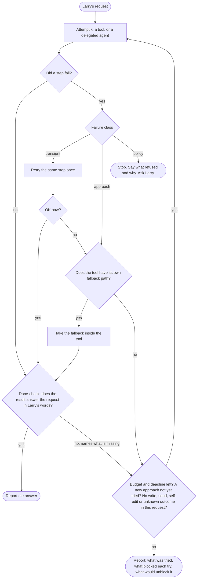

# Mortimer request resolution: fallbacks, failure classes, a bounded loop and a done-check

**Kind:** design note with options. No code changes. Larry picks options before any implementation row is claimed.
**Prepared:** 2026-11-19 by Claude (Opus 5.5, Claude Code cloud session), at Larry's request in his Claude Duet channel.
**Asked for:** Larry, 2026-11-19 03:04:04 UTC: "perhaps we need a workflow for requests that is persistent and works thru a loop to ensure he gets to resolution istead of giving up after a single try, thoughts". He then gave a thumbs-up to the coordinator's offer to write this up as a design note with options before any code.
**Code read:** `origin/next` `530f06c8` (2026-11-18 22:05 ET). The Mac runs `next` `b1f25e3`; `git diff b1f25e3 530f06c8` touches none of the files cited here except `jarvis/ambient_weather.py`, which this note does not rely on. `main` differs from `next` in these files only by one line in `jarvis/agents/delegate.py` and an addition to `jarvis/prompts.py`. Line numbers below are for `next`.
**Row:** WS-38 (proposed).

---

## 1. Recommendation in one paragraph

Build the loop, but make it a loop over *different approaches*, never over the same step. Start by tagging every failure with one of three classes: **transient** (retry the same step), **approach** (the step will fail again as is, so change the tool, input or agent) and **policy** (a guard refused on purpose, so stop and tell Larry). Most of this rides on code that already exists (`classify_tool_result` and the registry's `failure_category`). Then add three things. Each read-only tool gets its own hand-written fallback path, and a fallback never crosses a policy refusal. `delegate.py` gets an attempt ledger per request that enforces a try budget, a deadline and a "must change approach" rule across agents, not just within one agent as today. A done-check uses a host check where one exists and a model judgment against Larry's own words where none does. Retry attempts after the first run outside the voice turn and arrive through the existing late-delivery path. An attempt that ran a write, send or self-edit, or whose outcome is unknown, ends the loop and waits for Larry. Recommended picks: **1A, 2A, 3B, 4C**.

## 2. The proposed flow

Text version: attempt → classify any failure → transient: retry once; approach: the tool's own fallback, otherwise a new attempt with a different approach; policy: stop and ask → done-check → done: report; not done: a new attempt while budget, deadline and the side-effect rule allow; otherwise report the attempts. Attempt 1 runs inside the voice turn as it does today. Attempts 2 and later run detached and arrive by late delivery.

## 3. What happened at 9:51 PM on 2026-11-18

Read on 2026-11-19 at about 03:20 UTC from Mortimer's own run log (`/api/runs`, `/api/runs/<id>`) and bot log (`/api/status/logs`) on the Mac, through Larry's Chrome. Times are UTC (21:51 ET = 02:51 UTC).

| Time (UTC) | Run | Agent / model | What it did | Outcome |
|---|---|---|---|---|
| 02:51:00 | `bdfc7003` | Supervisor, direct tool | `local_weather` | Failed in about 2 ms (call 02:51:00.327, result 02:51:00.329). Result text redacted (`<sensitive>`). The bot log has no reason line. |
| 02:51:03 | `e37e306d` | Analyst, `claude-sonnet-5` | Task: "Get current weather, today's forecast, and the week ahead for the user's location, which is Alpharetta, Georgia." Called `get_weather` + `get_weather_radar` for "Alpharetta, Georgia", then **the same two calls with identical arguments** 1.4 s later. | 4/4 `{"ok": false, "error": "weather_reuse_invalid_request"}`, each in 0–1 ms. Run: "FAILED: every tool call in this run failed (4/4)". |
| 02:51:08 | — | bot log | `voice_workflow_injected hook=result name=voice-explain-failure kinds=failed` | Workflow step 2 says: delegate to developer to read the run log. |
| 02:51:10 | `5c3a4ca5` | Developer, `claude-opus-5` | "Read the run log for the most recent weather lookup attempt that just failed. Report the exact error message…" | OK, 3 tools, 9 s. |
| 02:51:36 | `20365a24` | Developer | "Troubleshoot why the weather service is returning weather_reuse_invalid_request for Alpharetta, Georgia…" | OK, 21 tools, 124 s. |
| 02:54:16 | `30703cff` | Developer | "Fix the weather intent logic in jarvis/bot/weather_reuse.py so that named-city weather requests… are permitted…" | FAILED, 10 tools, 79 s: "premise contradicted. No local_weather call sets intent (pipeline.py:429 derives it once per turn from the user's utterance…)". |
| 02:55:35 | — | bot log | `voice-explain-failure` injected again (`kinds=failed`) | |

**What the evidence shows**

1. **Mortimer did not give up after one try.** It made five delegated attempts across two agents over about 4.5 minutes, plus a repeat inside the analyst's own run. Larry still got no weather. Persistence was not what was missing. Direction was.
2. **Every retry repeated a deterministic refusal, and nothing said so.** The analyst repeated identical calls because the failure text (`weather_reuse_invalid_request`) doesn't say whether new arguments could help. The sub-agent's own instruction after a failure is "Either retry with corrected arguments, use a different tool, or tell the user…" (`jarvis/agents/base.py:265`, `TOOL_FAILURE_CONSTRAINT_TEMPLATE`), and a repeat with *uncorrected* arguments is not refused.
3. **The analyst's refusal was a policy guard working as designed, under a misleading code.** For "what's the weather", the turn's intent is `local` (`jarvis/bot/pipeline.py:429`). `WeatherIntent.permits` lets a `local` intent use only `local_weather` (`jarvis/bot/weather_intent.py:28-29`). This is the guard WS-15 built so the voice model can't supply a place from memory (`jarvis/bot/weather_tool.py:4-12`). The supervisor did exactly that ("which is Alpharetta, Georgia"), which its rule 11 also forbids ("never add details the user did not say", `jarvis/prompts.py:73`). `weather_reuse.py:153-155` reports that refusal as `invalid_request`, the same code it uses for malformed input (`weather_reuse.py:147-152`). So it reads as a bug to be fixed. A live-fetch fallback on *this* refusal would have bypassed the guard. [certain: read in code]
4. **The escalation picked the wrong kind of next step.** After the failure, the injected `voice-explain-failure` workflow sent the supervisor to the developer to read the run log (`config/workflows/voice-explain-failure.yaml`, step 2). From there the supervisor escalated to "fix the code", mid-request, on a premise the developer correctly rejected. A loop must never escalate a voice request into a code change.
5. **The first failure is still unexplained.** `local_weather` failed in about 2 ms, with no network fetch possible in that time. Its result is redacted because the supervisor's direct-tool run log is always marked sensitive (`jarvis/bot/pipeline.py:998`), and the bot log records no reason. Several early returns in `weather_tool.py` fit a 2 ms failure: protected turn (184-185), non-local intent (186-190), location lookup failed or unavailable (191-200), or a reuse refusal (215-217). Which one fired is **untested**. A closed reason code in the run log (§5) would have answered it. The separate weather thread owns this bug.

This corrects two details in the earlier chat summary. `local_weather` failed in about 2 ms; it did not return in 1.7 s. And there were four developer-or-analyst runs after it, not three.

## 4. What exists today

| Mechanism | Where | What it does | Gap for this design |
|---|---|---|---|
| One tool-result verdict | `jarvis/toolresult.py:41` `classify_tool_result` → `ToolOutcome(ok, error, body_failure)` | The single ok/failed judgement for registry, sub-agents and the voice wrapper | No retryability and no class |
| Closed failure categories | `jarvis/skills/registry.py` `_finish_invocation` (~800-812): `tool_timeout`, `tool_transport_error`, `tool_exception`, `mcp_tool_error`, `weather_reuse_<code>` | Logged to the run log as the `mcp_call` error; raw provider text is kept out | Not mapped to a class; not given to the model as one |
| Transport restart, retry once | `registry.py` ~1262-1280 | A dead MCP child is restarted and the call retried once; "never automatically replay a consequential start" (`_ADVISORY_STARTS`, line 119) | The only host-side retry. Its side-effect rule is the precedent to generalise. |
| Weather reuse refusals | `jarvis/bot/weather_reuse.py:121-125` `_REFUSAL_CODES` | One set mixes transient (`timeout`, `disconnected`, `not_ready`, `query_failed`), policy (`protected_turn`, `protected_result`) and input (`invalid_request`, `unsupported`) codes | Every refusal becomes a hard failure in `weather_tool.py:215-217` and `registry.py:1219-1225`; `invalid_request` also carries the intent guard |
| Sub-agent failure prompts | `jarvis/agents/base.py:265` single, `:279` batch, `:294` all-failed, `:146` iterations exhausted | Forbid inventing data; suggest retry, another tool or telling the user | Same text for every class; identical repeats allowed |
| Sub-agent result contract | `FAILED: <reason>`, `REFUSED:`, `NEEDS-INPUT:` (`delegate.py:200`), `MISSING-TOOL:` (`:207`), `HUMAN-ONLY PROPOSAL` (`voice_workflows.py:70`) | The supervisor reads these strings | No class in a `FAILED:` result |
| Retry guard (A2) | `jarvis/agents/delegate.py:581-633`, armed at `:789` | Refuses a reworded retry to the **same agent** within 120 s at token overlap ≥ 0.5, with three exemptions | Per agent only: analyst → developer passed straight through. Measures wording, not approach. |
| Duplicate pending operation | `delegate.py:666-674` | "ALREADY RUNNING" for an identical in-flight delegation | Fine as is |
| Handoff loop (H1/H2) | `delegate.py:217-223`, `docs/plans/MORTIMER_HANDOFF_LOOP_PLAN.md` | Earned continuations, findings carried between runs, a depth *notice* at 4 ("a cap is quitting on a timer") | The existing human-in-the-loop persistence; the ledger should reuse it, not compete with it |
| Supervisor rule 11 | `jarvis/prompts.py:73` | On FAILED: report the reason, ask how to proceed, never re-delegate a reworded task, never add details Larry didn't say | Prompt only; broken at 9:51 (the place was added) |
| `voice-explain-failure` | `config/workflows/voice-explain-failure.yaml`; injected by `voice_workflows.py:250` `wrap_delegate_handler` | On any FAILED result: report it; if there's no reason, delegate to developer to read the run log | Fires even when the result already holds a closed code; started the 9:51 chain |
| Workflow `done_when` | `jarvis/workflows.py:71`; injected at `base.py:1355-1372` | Authored done criteria in the prompt | "Guidance only — nothing here executes steps or blocks on done_when" (`base.py:1359`) |
| Host step checks | `jarvis/skill_step_checks.py`, `config/skill_step_checks.yaml` | Machine checks for exact skill revisions and steps, including `weather.current_and_forecast_returned` | The only machine done-check today; four mappings |
| Durable task contract (WS-24) | `jarvis/task_recovery.py` | Offline transition evaluator with attempts and `budget_exhausted` | No runtime wiring yet |
| Unknown outcomes | `base.py:1756-1768` `tool_outcome_unknown` | After a cancellation mid-call: "never continue this loop or retry the tool automatically" | Second side-effect precedent |
| Late delivery | `delegate.py:806-930`, `jarvis/bot/late_result.py` | Delegated work runs detached, survives barge-in, and reports into the next reply or the outbox | Ready-made path for attempts 2 and later |
| Side-effect metadata | — | `grep` for `readOnlyHint`, `destructiveHint`, `idempotentHint` and similar finds nothing | **Missing.** The side-effect rule needs a per-tool class. |
| Budgets | `config/agents.yaml`: analyst 15 rounds / 120 s, developer 25 / 300 s; defaults 5 / 45 s (`base.py:128-129`) | Per run | No per-request budget |

## 5. Piece 1: fallbacks inside each tool

When a step fails in a way that will repeat, the tool takes another path to the same answer before reporting failure.

| Option | What it is | Cost | Risk |
|---|---|---|---|
| **1A. Hand-written per tool (recommended)** | Each read-only tool codes its own chain. For example, `local_weather`: reuse refused for a non-policy reason → fetch live (`weather_tool.py:215-217` → the live branch at `:234`). Two rules: a cache is never the only path, and a fallback never crosses a policy refusal. | Small per tool. Tests sit beside the tool's existing ones. | Doesn't generalise by itself |
| 1B. Declarative fallback table | `config/tool_fallbacks.yaml`: tool + reason codes → alternative tool. `registry._invoke` consults it. | Medium: new config, registry hook, tests. Needs the side-effect classes first. | Hides behaviour in config; easy to route around a guard by accident |
| 1C. Advertise alternatives to the model | The failure body lists alternatives (`"try": ["get_weather live"]`) and the agent picks one | Small | Relies on the model; the analyst already ignored "use a different tool" |

Pick 1A now. Move to 1B only if three or more tools end up with the same chain. The weather case belongs to the separate weather thread and is not duplicated here. This note only sets the rule that its fix should follow: a reuse refusal of class `transient` or `approach` falls through to live, and `policy` never does.

## 6. Piece 2: failure classes

Every tool and delegate failure carries a class and a closed reason code.

| Class | Meaning | Who acts | Examples today |
|---|---|---|---|
| `transient` | The same step may succeed if retried | Host retries once | `tool_timeout`, `tool_transport_error`, reuse `timeout` / `disconnected` / `not_ready` / `query_failed` |
| `approach` | The same step will fail again; another tool, input or agent may succeed | Tool fallback, then a new attempt | `mcp_tool_error` with bad input, reuse `invalid_request` (malformed), `unsupported`, all-tools-failed, iterations exhausted |
| `policy` | A guard refused on purpose | Stop and tell Larry; never route around it | reuse `protected_turn` / `protected_result`, the weather intent guard, retry guard, privacy route refusals (`base.py:1755`) |

| Option | What it is | Cost | Risk |
|---|---|---|---|
| **2A. Three classes + closed reason code (recommended)** | Add `failure_class` and `reason` to `ToolOutcome`, derived in `classify_tool_result` from the registry's `failure_category` or the body's `error` code through one table. `FAILED:` results from `delegate.py` carry the class (`FAILED[approach:weather_reuse_unsupported]: …`). Split the weather intent refusal out of `invalid_request` into `weather_place_not_requested` (policy). | Medium: `toolresult.py`, the registry, `base.py` templates, `delegate.py`, `voice_workflows.result_kinds`, the reuse codes, tests | A code with no table entry needs a default; use `approach` so nothing retries blindly |
| 2B. Retryable yes/no only | One boolean | Small | Loses the policy/approach split that was the crux at 9:51: a "not retryable" guard and a "not retryable" bad input need opposite next steps |
| 2C. Prompt only | Tell agents to judge retryability from the text | Smallest | Already failed: the analyst repeated identical calls |

With 2A, three host behaviours follow, each small:

- **Identical-repeat block:** within one sub-agent run, a call with the same tool and arguments as an earlier `approach` or `policy` failure is refused before dispatch (`base.py` `_loop`, at the batch-failure handling near `:1882`). That stops the analyst's second pair of calls.
- **Reason codes survive redaction:** a sensitive run logs the closed reason code, never content (`pipeline.py:998` and the `runlog.tool_result` call near `:1031`). That would have named tonight's `local_weather` failure.
- **The workflow stops over-escalating:** `voice-explain-failure` step 2 fires only when the result has no reason code (`voice_workflows.py:131` `result_kinds` gains a `reasoned` kind; the YAML step is reworded). With a code in hand, the supervisor reports it rather than sending the developer to read the log.

## 7. Piece 3: a bounded resolution loop for delegated work

| Option | What it is | Cost | Risk |
|---|---|---|---|
| 3A. Host-run loop | `delegate.py` re-dispatches on its own after an `approach` failure or a failed done-check, choosing the next agent or approach itself | High: a second planner in the host | The host doesn't know the alternatives; it would guess, or need a model, which makes it a second supervisor |
| **3B. Attempt ledger under the supervisor (recommended)** | The supervisor still chooses each next step. `delegate.py` keeps a ledger per request (keyed by the foreground request already in `pipeline.py:992`): each attempt's agent, tools used, failure class and reason, and its approach fingerprint. It enforces the budget, deadline and rules below, and appends `attempt k of N; tried: …; blocked by: …` to every result. This generalises the A2 retry guard from "same agent, similar words" to "any agent, same approach", and uses the class instead of token overlap. | Medium: `delegate.py` handler (`:528` on), the result text, prompt rule 11, tests. Reuses `last_failure`, the handoff depth counter and late delivery. | Still relies on the supervisor model to pick a good next approach. The ledger only stops bad ones and keeps it honest. |
| 3C. Durable task lifecycle | Persist attempts, leases and budgets in WS-24's model so a loop survives restarts | High; parked behind WS-24/WS-22 | Right long-term home. Too much to build first. |

**Rules for 3B**

- **Budget:** 3 attempts per request, and a deadline of the longest participating agent's `timeout_s` plus 60 s (developer: 360 s). These are starting values chosen by me, not measured. Tune them against the run log after a week.
- **Each attempt must change approach.** It needs a different agent, or a different tool set, or a different input the request supports. A fingerprint the ledger already holds is refused with the ledger's own words ("tried; blocked by …").
- **Policy ends the loop.** So does a `NEEDS-INPUT:` handoff, which hands over to the existing handoff loop (Larry's answer earns a continuation, as today).
- **Side effects end the loop.** If an attempt ran a tool whose class is `write`, `send` or `self-edit`, or produced `tool_outcome_unknown`, no further attempt starts without Larry's word. This needs a per-tool side-effect class, which doesn't exist yet (§4). Recommended source: MCP tool annotations (`readOnlyHint`, `destructiveHint`) on each `mcp_servers/*` tool, plus a host table for the supervisor's direct tools. Unannotated tools count as side-effecting.
- **No self-edit inside a loop.** A proposed code change comes back as a `HUMAN-ONLY PROPOSAL` result, never a self-edit start.
- **Voice latency:** attempt 1 behaves as today. Attempts 2 and later run detached. The supervisor says once that it's trying another way, and the result arrives through late delivery (`delegate.py:806-930`). No voice turn waits on a retry.
- **Exhaustion report:** when the budget or deadline runs out, the result is the ledger: what was tried, what blocked each try, and what would unblock it. That's what `voice-explain-failure` relays.

**Rows:** 3B touches the A2 guard and WS-06's open acceptance item "corrected retry" ("Alfreda" → "I meant Alpharetta" succeeds). The substitution exemption must keep passing. Its ledger should match the attempt record of WS-24 (`task_recovery.py`), so 3C can adopt it later without a second store.

## 8. Piece 4: a done-check before reporting success

| Option | What it is | Cost | Risk |
|---|---|---|---|
| 4A. Host checks per request kind | Extend `skill_step_checks.py` to request kinds: weather (current + forecast, *for the place in Larry's words or his device*), reminder (row exists), note (stored) | Small per kind; narrow | Covers only kinds with a check |
| 4B. Model judgment | A small model compares the result to Larry's own words: "does this answer it? what's missing?" | One extra model call per delegated result, through existing routing and budget (WS-05) | Can be wrong; adds latency |
| **4C. Host check where one exists, model judgment otherwise, driven by `done_when` (recommended)** | 4A for weather, reminders and notes. 4B only for delegated results inside a loop, given the matched workflow's `done_when` as its checklist when there is one. Never on a direct voice tool's path. | Medium | 4B's error rate is untested; measure it on the run log before trusting it to start attempts |

A failed done-check counts as an `approach` failure: it names what's missing, and the ledger decides whether another attempt fits. The weather host check would also have caught tonight's first wrong turn, because Alpharetta was not in Larry's words.

## 9. The 9:51 request under the recommendation

1. `local_weather` fails with a logged reason code. If the code is transient, the host retries once. If it's a reuse refusal that isn't policy, the tool fetches live (1A). If the location is unavailable, the existing text asks "which place?" (`weather_tool.py:63-70`).
2. If the supervisor still delegates "Alpharetta" from memory, the analyst's call is refused as `policy: weather_place_not_requested`. The analyst can't repeat the identical call, the delegate result is `FAILED[policy:…]`, and the ledger ends the loop.
3. The supervisor says it couldn't get the device's location and asks which city. No developer runs, no code change, and about 5 seconds instead of 4.5 minutes.

This does not by itself get Larry the weather. That still depends on `local_weather`'s own failure, which the weather thread is fixing. What it changes is that Mortimer fails fast and honestly, and asks the right question.

## 10. Hook points, cost and rows

| Piece | Files and functions | Size | Rows |
|---|---|---|---|
| 1A fallbacks | `jarvis/bot/weather_tool.py` handler `:215-217`; `jarvis/skills/registry.py` `_invoke` `:1219-1225` (named weather) | S per tool | WS-15 |
| 2A classes | `jarvis/toolresult.py` `ToolOutcome` / `classify_tool_result`; `registry.py` `_finish_invocation`; `jarvis/bot/weather_reuse.py` `_REFUSAL_CODES` + intent refusal `:153-155`; `jarvis/agents/base.py` templates `:265-297` and `_loop` near `:1882`; `jarvis/agents/delegate.py` result text; `jarvis/voice_workflows.py` `result_kinds`; `config/workflows/voice-explain-failure.yaml`; `jarvis/bot/pipeline.py` wrapper `:989-1040` (reason code on sensitive runs) | M | WS-07, WS-15, WS-34 (holds `jarvis/bot/pipeline.py` in its scope) |
| 3B ledger | `delegate.py` `build_delegate_tool` handler `:528` on, `_execute` `:722`, guard `:581-633`; `jarvis/prompts.py` rule 11; side-effect classes on `mcp_servers/*` tool definitions plus a host table | M–L (side-effect tagging is most of it) | WS-07, WS-06 (corrected-retry item), WS-24 (attempt record) |
| 4C done-check | `jarvis/skill_step_checks.py` + `config/skill_step_checks.yaml`; a judge call through `jarvis/model_routing.py`; `jarvis/workflows.py` `done_when` | M | WS-05 (model routing and budget), WS-22 (parked; R4 host authority, R8 honest completion) |

Suggested order: 2A (it makes everything else safe and would have explained tonight), then 1A, then the side-effect classes, then 3B, then 4C. Before any code: check §2 scope locks, because WS-34 holds `jarvis/bot/pipeline.py`.

## 11. Decisions for Larry

1. Accept the three classes (2A), or prefer a yes/no flag (2B)?
2. Should the loop's later attempts run in the background with late delivery (recommended), or should the voice turn wait for them?
3. Starting budget: 3 attempts and a deadline of the longest agent's timeout + 60 s?
4. Should unannotated tools count as side-effecting (recommended, safe) or read-only (faster to adopt)?
5. May a small model judge done-ness for delegated results (4B part of 4C), given one extra model call each?

---

*Attribution: Claude (Opus 5.5), Claude Code cloud session for Larry's Claude Duet channel, 2026-11-19. Evidence: run log and bot log read on the Mac through Larry's Chrome, about 03:20 UTC; code at `origin/next` `530f06c8`.*
